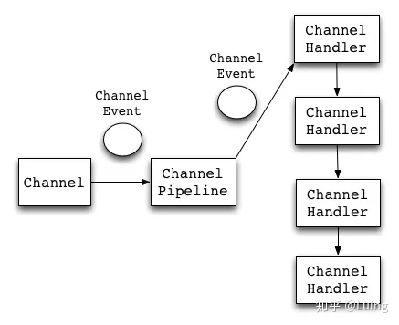
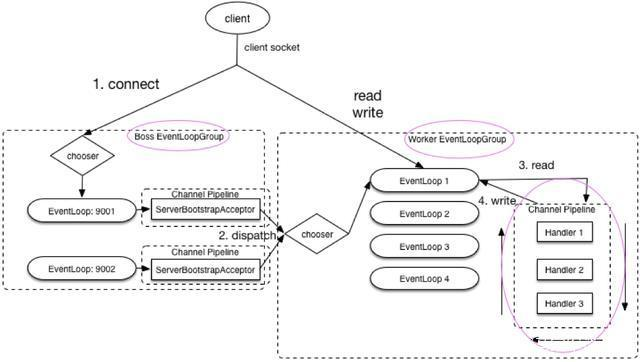
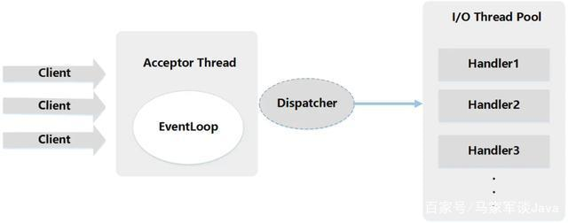
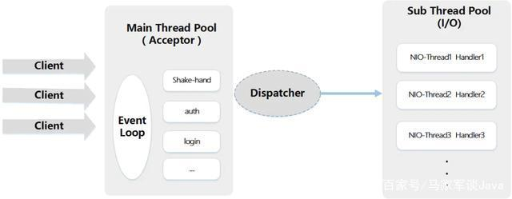

# CSE351 - Java I/O - Netty

返回[Bulletin](./bulletin.md)

返回[CSE351 - Java I/O](./CSE351.md)

[TOC]

## 定义

Netty是一款基于NIO开发的网络通信框架，封装了事件处理的流程。对比于BIO, 它的并发性能得到了很大提高，同时保持了可维护性和性能等优势。

## 应用场景

Netty主要用来做网络通信，NIO可以做的事情，使用Netty都可以做并且更好。

### 作为 RPC 框架的网络通信工具

我们在分布式系统中，不同服务节点之间经常需要相互调用，这个时候就需要 RPC 框架了。不同服务节点之间的通信是如何做的呢？可以使用 Netty 来做。比如我调用另外一个节点的方法的话，至少是要让对方知道我调用的是哪个类中的哪个方法以及相关参数吧！

### 实现一个自己的 HTTP 服务器

通过 Netty 我们可以自己实现一个简单的 HTTP 服务器，这个大家应该不陌生。说到 HTTP 服务器的话，作为 Java 后端开发，我们一般使用 Tomcat 比较多。一个最基本的 HTTP 服务器要可以处理常见的 HTTP Method 的请求，比如 POST 请求、GET 请求等等。

### 实现一个即时通讯系统

使用 Netty 我们可以实现一个类似微信的即时通讯系统，这方面的开源项目还蛮多的，可以自行去 Github 找一找。

### 实现消息推送系统

市面上有很多消息推送系统都是基于 Netty 来做的。

## 核心组件



### Channel

Channel接口是Netty对网络操作的抽象，包含了bind()、connect()、read()、write() 等基本I/O操作。

比较常用的Channel接口实现类是NioServerSocketChannel（服务端）和NioSocketChannel（客户端），这两个 Channel 可以和 BIO 编程模型中的ServerSocket以及Socket两个概念对应上。Netty 的 Channel 接口所提供的 API，大大地降低了直接使用 Socket 类的复杂性。

### EventLoop

EventLoop（事件循环）接口的主要作用就是负责监听注册到其上的Channel产生的ChannelEvent并调用ChannelHandler进行相关I/O操作的处理。

### ChannelFuture

Netty是异步非阻塞的，因此不能立刻得到操作是否执行成功。

但是可以通过ChannelFuture接口的addListener()方法注册一个ChannelFutureListener, 当操作执行成功或者失败时，监听就会自动触发返回结果。

channel()方法可以获取关联的Channel.

sync()方法可以让异步的操作变成同步的。

### ChannelHandler

ChannelHandler是消息的具体处理器，负责处理读写操作、客户端连接等事情。

### ChannelPipeline

ChannelPipeline为ChannelHandler 的链，提供了一个容器并定义了用于沿着链传播入站和出站事件流的API. 当Channel被创建时，它会被自动地分配到它专属的ChannelPipeline.

addLast()方法可以添加一个或者多个ChannelHandler, 因为一个数据或者事件可能会被多个Handler处理。当一个ChannelHandler处理完之后就将数据交给下一个ChannelHandler.

### EventLoopGroup

包含多个EventLoop, 每一个EventLoop通常内部包含一个专有的处理事件的线程，1:1的关系保证线程安全。

当客户端通过connect方法连接服务端时，bossGroup处理客户端连接请求。

当客户端连接请求处理完成后，会将这个连接提交给workerGroup来处理其IO相关操作。



## 线程模型

### 单线程模型

一个线程需要执行处理所有的 accept、read、decode、process、encode、send 事件。

对于高负载、高并发，并且对性能要求比较高的场景不适用。

```java
//1.eventGroup既用于处理客户端连接，又负责具体的处理。
//传入1表示单线程；无参构造函数线程数量的默认值就是CPU 核心数*2
EventLoopGroup eventGroup = new NioEventLoopGroup(1);
//2.创建服务端启动引导/辅助类：ServerBootstrap
ServerBootstrap b = new ServerBootstrap();
b.group(eventGroup, eventGroup);
//......
```

### 多线程模型

一个Acceptor线程只负责监听客户端的连接，一个NIO线程池负责具体处理：accept、read、decode、process、encode、send 事件。

满足绝大部分应用场景，并发连接量不大的时候没啥问题，但是遇到并发连接大的时候就可能会出现问题，成为性能瓶颈。

```java
//  1.bossGroup 用于接收连接，workerGroup 用于具体的处理
EventLoopGroup  bossGroup = new NioEventLoopGroup(1);
EventLoopGroup  workerGroup = new NioEventLoopGroup();
try {
    //2.创建服务端启动引导/辅助类：ServerBootstrap
    ServerBootstrap  b = new ServerBootstrap();
    //3.给引导类配置两大线程组,确定了线程模型
    b.group(bossGroup,  workerGroup);
    //......
```



### 主从多线程模型

从一个主线程NIO线程池中选择一个线程作为Acceptor线程，绑定监听端口，接收客户端连接，其他线程负责后续的接入认证等工作。连接建立完成后，子NIO线程池负责具体处理 I/O 读写。

如果多线程模型无法满足需求，可以考虑使用主从多线程模型。

```java
//  1.bossGroup 用于接收连接，workerGroup 用于具体的处理
EventLoopGroup  bossGroup = new NioEventLoopGroup();
EventLoopGroup  workerGroup = new NioEventLoopGroup();
try {
    //2.创建服务端启动引导/辅助类：ServerBootstrap
    ServerBootstrap b = new ServerBootstrap();
    //3.给引导类配置两大线程组,确定了线程模型
    b.group(bossGroup,  workerGroup);
    //......
```



## 高并发长连接：靠什么支撑【P0】

Netty 用少量 I/O 线程支撑数万级并发 TCP 长连接，靠的从来不是"NIO 单次读写比 BIO 快"，而是线程模型：一个 EventLoop 线程通过 Selector 同时注册并轮询成千上万个 Channel，哪个连接有事件就处理哪个，没有事件就阻塞在 select/epoll 上等待。长连接的常态是空闲——大部分时间里连接上没有数据，BIO 给每个连接独占一个线程，空闲时线程被白白挂住；NIO + Reactor 让空闲连接不占线程，线程只花在真正有事件的连接上。开销的大头于是从"每连接一个线程的栈内存 + 上下文切换"，变成"每连接一个 Channel 对象 + 一个文件描述符"，并发连接数自然就能上去。

EventLoopGroup 就是 Reactor 的线程池实现：I/O 多路复用负责监听事件，分发器把就绪事件派发给对应的 Handler。Linux 下 Selector 的底层是 epoll（水平/边缘触发），返回就绪连接的成本不随连接总数线性增长。I/O 模型的完整对比见 CSE3511；从 epoll_wait 到 Reactor 的推导见 SYS3014。

还有一个容易被忽略的点：每个 Channel 一旦分配给某个 EventLoop，生命周期内不再换线程，因此单个 Channel 上的 I/O 处理天然单线程串行，Netty 内部得以大量无锁设计。所以连接数能上得去，靠的是"一个线程盯一万个连接"，而不是"一个连接读写更快"。

## EventLoop 阻塞禁忌【P0】

EventLoop 上跑慢 SQL，被拖住的不是这一个请求，而是这个 EventLoop 名下**所有** Channel 的读、写和定时任务。后果链很直接：

```text
某个 Handler 里跑了慢 SQL / 慢 RPC
  → 这个 EventLoop 被占住
  → 它名下其他连接读写推迟、心跳超时
  → 被对端断开
  → 连接抖动放大成批量掉线
```

所以规则只有一条：**I/O 线程只做拆包编解码、协议解析、快速校验，业务处理（DB、RPC、重计算）一律交给独立业务线程池**（DefaultEventExecutorGroup 或自定义 Executor）。并且业务线程池必须配有界队列和明确拒绝策略——无限排队等于把"快速失败"变成"全员慢死"，背压形同虚设。

## 粘包拆包与编解码【P0】

TCP 是字节流，不保留消息边界，接收方读到的可能是半条消息，也可能是两条消息粘在一起。成因与三类通用解法（长度字段、固定长度、分隔符）见 SYS2013；Netty 里负责把字节流还原成消息的是 ByteToMessageDecoder 体系，三个常用拆包器按协议格式选：

| 拆包器 | 适用协议 | 原理 |
| --- | --- | --- |
| FixedLengthFrameDecoder | 定长报文 | 每 N 字节切一帧 |
| DelimiterBasedFrameDecoder | 文本协议 | 按分隔符（如 \n）切帧 |
| LengthFieldBasedFrameDecoder | 带长度字段的二进制协议 | 按帧头长度字段切帧，最通用 |

LengthFieldBasedFrameDecoder 只需要配好四个参数：长度字段的偏移、长度字段占几个字节、长度值是否包含帧头自身、解码后是否剥离长度字段。

```java
// 帧格式：| 4字节长度(含自身) | payload |
ch.pipeline().addLast(new LengthFieldBasedFrameDecoder(
        65536,   // 最大帧长，防超大帧攻击
        0,       // lengthFieldOffset
        4,       // lengthFieldLength
        0,       // lengthAdjustment：长度已含自身，无需调整
        4));     // initialBytesToStrip：解码后剥掉长度字段
```

这里有两处工程细节不能漏。最大帧长是长连接服务的基本盘：对端发恶意超大帧时直接抛 TooLongFrameException，防止内存被打爆。EPP 协议就是 4 字节长度前缀封帧，正好对应这个解码器。串起来说：TCP 无边界，按协议格式选拆包器，长度字段类协议用 LengthFieldBasedFrameDecoder，同时用最大帧长做防护。

## 心跳、空闲检测与断线恢复【P0】

长连接不能只靠操作系统通知断连：对端进程崩溃或网络分区时，本端 TCP 栈往往不会立刻得到通知，read 可能长时间阻塞不返回。所以应用层要主动发现——读空闲超过阈值没收到任何数据，就判定连接可疑。

Netty 的空闲检测组件对应三种策略：

- **IdleStateHandler**：分别统计读/写/双向的空闲时间，触发 IdleStateEvent（在 userEventTriggered 里捕获），适合"先提醒、再决定"的场景；
- **ReadTimeoutHandler**：读超时直接断开连接，适合"必须持续收到数据"的场景；
- 心跳 Handler：空闲触发时发送 ping，连续 N 次无响应主动 close，比单纯等超时更果断。

断线恢复有三条纪律。客户端重连要指数退避（1s、2s、4s……封顶），避免服务端重启瞬间被重连风暴再次打垮；重连后必须重建会话状态（重新 login、重建上下文），旧 Channel 上的状态假设全部作废；并且区分"连接断了"和"结果未知"——请求发出后断连，结果未知，不能直接按失败重试（见 SYS3011 Timeout/Retry）。

线上排查时两个状态值得记住：CLOSE_WAIT 堆积说明对端已关闭而本端应用没有 close socket，通常是应用代码泄漏了连接句柄，从应用侧查；TIME_WAIT 是主动关闭方的正常状态，量大时考虑 tcp_tw_reuse + timestamps（仅客户端方向）。细节见 SYS2013 四次挥手一节。

## ByteBuf 与内存管理【P0】

ByteBuf 相对 NIO ByteBuffer 的核心改进是三点：readerIndex / writerIndex 读写双指针，不用 flip；可动态扩容；支持池化与堆外分配。

| 维度 | 类型 | 说明 |
| --- | --- | --- |
| 内存位置 | HeapByteBuf | 分配/回收快，数据进内核时多一次堆内外复制 |
|  | DirectByteBuf | 减少一次内核拷贝，适合 I/O 读写，分配回收成本高 |
| 回收方式 | Pooled | 从池中取/还，减少分配开销，引用计数管理 |
|  | Unpooled | 普通分配，交给 GC |

Direct + Pooled 是高性能组合，代价是内存管理责任转移到开发者肩上。Pooled ByteBuf 基于引用计数（refCnt），规则是**最后一个使用它的 Handler 负责 release**：入站消息若走到 pipeline 尾部还没人 release，计数不归零，池化内存越借越少，最终堆外 OOM。工程上的防线是开发期开 `-Dio.netty.leakDetectionLevel=paranoid`，日志出现 "LEAK" 字样即可定位释放责任，线上用 advanced 采样；堆外内存的排查 SOP（含 NMT 观察 Netty 堆外增长）见 CSE381 Direct Memory OOM 一节。

发送侧同样不能只顾着写：每个连接有写缓冲（ChannelOutboundBuffer），对端消费慢时积压上涨，要用 `Channel.isWritable()` 和 WRITE_BUFFER_WATER_MARK（默认 32K 低水位 / 64K 高水位）做背压，发送路径把 isWritable 纳入判断——否则一个慢消费者就能把进程的堆外内存拖垮。生产上两道保险缺一不可：泄漏检测管住 release 责任，背压水位管住慢消费者。

## 启动流程

### 服务端

```java
// 1.bossGroup 用于接收连接，workerGroup 用于具体的处理 
EventLoopGroup bossGroup = new NioEventLoopGroup(1); 
EventLoopGroup workerGroup = new NioEventLoopGroup(); 
try { 
    //2.创建服务端启动引导/辅助类：
    ServerBootstrap b = new ServerBootstrap();
    //3.给引导类配置两大线程组,确定了线程模型 
    b.group(bossGroup, workerGroup) 
        // (非必备)打印日志 
        .handler(new LoggingHandler(LogLevel.INFO)) 
        // 4.指定 IO 模型 
        .channel(NioServerSocketChannel.class) 
        .childHandler(new ChannelInitializer<SocketChannel>() { 
            @Override 
            public void initChannel(SocketChannel ch) { 
                ChannelPipeline p = ch.pipeline(); 
                //5.可以自定义客户端消息的业务处理逻辑 
                p.addLast(new HelloServerHandler()); 
            } 
        }); 
    // 6.绑定端口,调用 sync 方法阻塞直到绑定完成
    ChannelFuture f = b.bind(port).sync(); 
    // 7.阻塞等待直到服务器Channel关闭(closeFuture()方法获取Channel 的CloseFuture对象,然后调用sync()方法) 
    f.channel().closeFuture().sync(); 
} finally { 
    //8.优雅关闭相关线程组资源 
    bossGroup.shutdownGracefully(); 
    workerGroup.shutdownGracefully(); 
}
```

### 客户端

```java
//1.创建一个 NioEventLoopGroup 对象实例 
EventLoopGroup group = new NioEventLoopGroup();
try {
    //2.创建客户端启动引导/辅助类：
    Bootstrap b = new Bootstrap();
    //3.指定线程组 
    b.group(group) 
        //4.指定 IO 模型 
        .channel(NioSocketChannel.class) 
        .handler(new ChannelInitializer<SocketChannel>() { 
            @Override 
            public void initChannel(SocketChannel ch) throws Exception { 
                ChannelPipeline p = ch.pipeline(); 
                // 5.这里可以自定义消息的业务处理逻辑 
                p.addLast(new HelloClientHandler(message)); 
            } 
        }); 
    // 6.尝试建立连接 
    ChannelFuture f = b.connect(host, port).sync(); 
    // 7.等待连接关闭（阻塞，直到Channel关闭） 
    f.channel().closeFuture().sync(); 
} finally { 
    group.shutdownGracefully(); 
}
```

