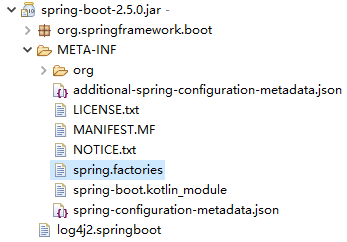
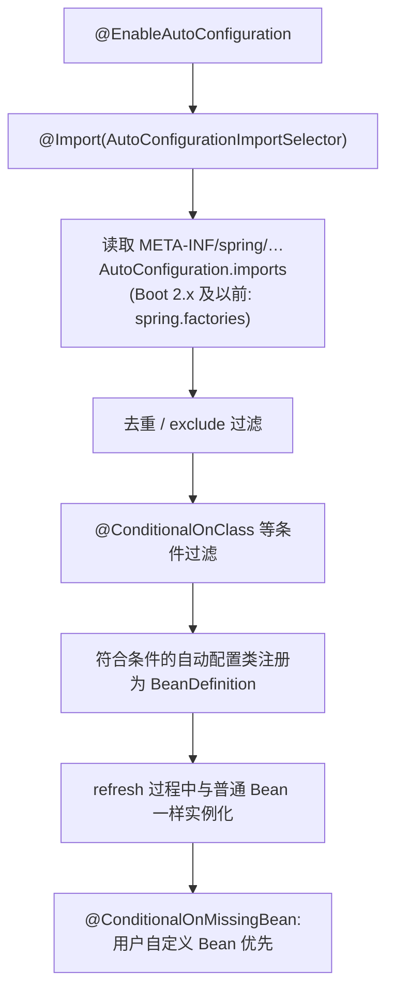
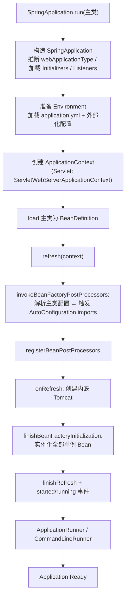
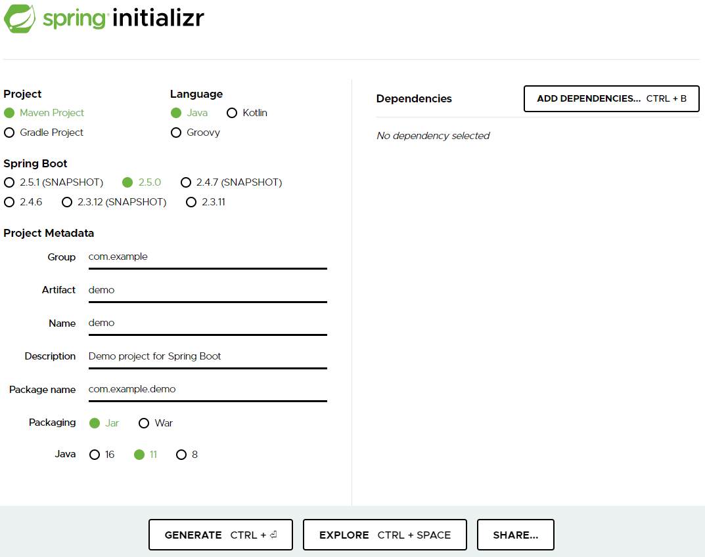

# CSE401 - Spring Ecosystem - Spring Boot

返回[Bulletin](./bulletin.md)

返回[CSE401 - Spring Ecosystem](./CSE401.md)

[TOC]

> Spring Boot 建立在 Spring Framework 的 IoC 容器之上（见 [Spring Framework Core](./CSE4011.md)），Web 层细节见 [Spring Web & MVC](./CSE4013.md)。本章正文聚焦启动主流程、自动配置机制与配置体系；`SpringApplication.run` 的 19 步启动流程源码要点分析见 [Appendix A — 启动流程源码 Deep Dive](#appendix-a--启动流程源码-deep-dive)，旧版实战教程完整保留在 [Appendix B — 历史实战教程](#appendix-b--历史实战教程)。

## Spring Boot 解决什么问题

Spring Framework 时代（XML/Java 配置 + 外部 Tomcat）搭建一个 Web 工程需要：手写一堆 XML、管理几十个依赖版本、部署 WAR 到外部容器。Spring Boot 的答案：

- **约定优于配置**：默认值即最佳实践，需要时再覆盖。
- **Starter 依赖聚合**：一个 starter 拉齐一个场景的全部依赖与版本。
- **自动配置**：按 classpath 里有什么，自动装配对应的 Bean。
- **内嵌服务器**：`java -jar` 直接跑起一个 Web 服务，无需外部容器。

Boot 不是"另一个 Spring"——它就是 Spring Framework + 脚手架 + 自动配置层。面试一句话：**Boot 简化的是"搭建与配置"，IoC/AOP/MVC 等核心机制全部还是 Framework 的**。

## 基本介绍

Spring Boot是Spring开源组织下的子项目，通过Spring组件一站式解决方案来简化Spring应用的初始搭建以及开发过程。

- 项目可以通过命令java -jar xxx.jar以jar包的形式**独立运行**。

- 内嵌**servlet容器**，可以内嵌tomcat, jetty, 或者undertow，这样就可以不用war包形式部署项目。

- Spring提供了一系列starter pom来**简化**maven的**依赖**加载，当使用了spring-boot-starter-web时，会自动加载所需要的依赖包。

- Spring Boot会根据在类路径的jar包，类，为jar包中的类**自动配置**bean，这样会极大的减少配置的使用。

> 2026 视角：内嵌容器默认 Tomcat 10+（Jakarta namespace），`java -jar` 是生产部署最常见形态；WAR + 外部容器只保留给少数传统运维场景。

## 入口类与 @SpringBootApplication

Spring Boot的项目一般都会有名称以Application结尾的入口类，入口类中会有main方法，这是一个标准的Java应用程序的入口方法。

```java
@SpringBootApplication
@ComponentScan("com.github.ltprc")
public class SpringBootProjectApplication {
    public static void main(String[] args) {
        SpringApplication.run(SpringBootProjectApplication.class, args);
    }
}
```

`@SpringBootApplication` 是组合注解：

| 组成注解 | 作用 |
| -------- | ---- |
| @SpringBootConfiguration | 本质是 @Configuration，标识入口类本身是一个配置类；Boot 内部通过它查找主配置类 |
| @EnableAutoConfiguration | 开启自动配置（见下） |
| @ComponentScan | 组件扫描，默认扫描入口类所在包及子包 |

```java
@Target(ElementType.TYPE)
@Retention(RetentionPolicy.RUNTIME)
@Documented
@Configuration
@Indexed
public @interface SpringBootConfiguration {
    //...
}
```

> 原表述"推荐使用@SpringBootConfiguration替代@Configuration"容易误导：两者语义相同，区别只是 Boot 在检索主配置类时认 `@SpringBootConfiguration`。自己写的普通配置类用 `@Configuration` 即可。

### @ComponentScan

@ComponentScan注解默认扫描@SpringBootApplication所在类的同级目录以及它的子目录，可以将路径作为字符串参数写入注解内，注解会扫描对应路径下的类。

这也是入口类约定放在根包的原因——放错包会导致业务 Bean 全部不被扫描，是最常见的"注入失败"根因之一。

### @EnableAutoConfiguration

@EnableAutoConfiguration注解会使Spring Boot根据项目中依赖的jar包启用自动配置。



例如我们如果添加了spring-boot-starter-web的依赖，项目中就会引入SpringMVC的依赖，Spring Boot就会自动配置tomcat和SpringMVC.

关闭某一项自动配置的方法如下所示：

```java
@SpringBootApplication(exclude = {XXXConfiguration.class})
```

> 其背后的完整加载链见下文"自动配置如何生效"；`spring.factories` → `AutoConfiguration.imports` 的机制迁移表述见下文"演进"一节。

### @Conditional

自动配置类在一定条件下才能生效

| @Conditional扩展注解            | 作用                                     |
| ------------------------------- | ---------------------------------------- |
| @ConditionalOnJava              | 系统的java版本是否符合要求               |
| @ConditionalOnBean              | 容器中存在指定Bean                       |
| @ConditionalOnMissingBean       | 容器中不存在指定Bean                     |
| @ConditionalOnExpression        | 满足SpEL表达式                           |
| @ConditionalOnClass             | 系统中有指定的类                         |
| @ConditionalOnMissingClass      | 系统中没有指定的类                       |
| @ConditionalOnSingleCandidate   | 容器中只有一个指定的Bean，或者是首选Bean |
| @ConditionalOnProperty          | 系统中指定的属性是否有指定的值           |
| @ConditionalOnResource          | 类路径下是否存在指定资源文件             |
| @ConditionOnWebApplication      | 当前是web环境                            |
| @ConditionalOnNotWebApplication | 当前不是web环境                          |
| @ConditionalOnJndi              | JNDI存在指定项                           |

其中 `@ConditionalOnMissingBean` 是"用户配置优先于默认配置"的实现基石：自动配置类总是先检查用户是否已自定义该 Bean，没有才装配默认实现。

## 自动配置如何生效

把 @EnableAutoConfiguration 的机制串成一条链（面试常问"自动配置原理"）：



要点：

- 自动配置类本质是带 `@Conditional` 的 `@Configuration` 类，最终以普通 BeanDefinition 进入容器，走同一条 refresh/实例化链路。
- `spring-boot-autoconfigure` jar 里每个 `XXXAutoConfiguration` 对应一个场景（web、data-jpa、kafka…），通过 `XXXProperties`（`@ConfigurationProperties`）绑定用户配置。
- 排查"为什么没生效"：看条件（ConditionEvaluationReport，`--debug` 启动可打印）→ 看用户是否自己定义了 Bean（`@ConditionalOnMissingBean` 让位）→ 看依赖是否在 classpath。

## SpringApplication.run 主流程

面试要求能把整条链串起来：



10 句话版本：

1. 构造 `SpringApplication`：推断应用类型（SERVLET/REACTIVE/NONE），从 `spring.factories` 加载 Initializer 和 Listener。
2. `starting()` 事件广播。
3. 准备 `Environment`：把 `application.yml`、环境变量、命令行参数等合成一个 `PropertySource` 链。
4. 打印 Banner。
5. 按应用类型创建 `ApplicationContext`（Web 对应 `ServletWebServerApplicationContext`）。
6. 把主类注册为 BeanDefinition，`prepareContext` 完成。
7. `refresh(context)`：与 Framework 的 refresh 同一条链（见 [CSE4011 工作流程](./CSE4011.md)），其中 ConfigurationClassPostProcessor 解析 `@SpringBootApplication`，触发自动配置导入。
8. `onRefresh()` 里创建内嵌 Tomcat 并绑定端口。
9. `finishBeanFactoryInitialization` 实例化所有非懒加载单例 Bean。
10. `started/running` 事件 + 执行 `ApplicationRunner`/`CommandLineRunner`，应用就绪。

### 启动事件时间线

| 事件 | 时机 | 典型用途 |
| ---- | ---- | -------- |
| ApplicationStartingEvent | run 一开始，容器创建前 | 极早期初始化（日志、注册表） |
| ApplicationEnvironmentPreparedEvent | Environment 准备好，容器创建前 | 修改配置源 |
| ApplicationContextInitializedEvent / ContextPreparedEvent | 容器创建/准备完成 | 提前注册 Bean |
| ContextRefreshedEvent | refresh 完成（Framework 事件） | 容器就绪 |
| ApplicationStartedEvent | refresh 完成后、Runner 执行前 | — |
| ApplicationReadyEvent | Runner 执行完，可以接流量 | 缓存预热后的最后一步 |

自定义初始化逻辑挂哪一层：改配置 → Environment 阶段事件；注册 Bean → `ApplicationContextInitializer`；业务预热 → `ApplicationRunner`。

### ApplicationRunner 与 CommandLineRunner

容器就绪后、`ApplicationReadyEvent` 之前的钩子，适合做缓存预热、初始数据加载：

```java
@Component
public class WarmupRunner implements ApplicationRunner {
    @Override
    public void run(ApplicationArguments args) {
        // 预热缓存、校验外部依赖
    }
}
```

> 构造方法与 19 步流程的源码要点见 [Appendix A](#appendix-a--启动流程源码-deep-dive)。

## 内嵌 Web Server

在使用springboot搭建一个web应用程序的时候，我们发现不需要自己搭建一个tomcat服务器，只需要引入spring-boot-starter-web, 在应用启动时会自动启动嵌入式的tomcat作为服务器。

在自动装配时，配置类ServletWebServerFactoryAutoConfiguration导入了BeanPostProcessorRegister. 该类实现了ImportBeanDefinitionRegister接口，可以用来注册额外的BeanDefinition. 同时，该类还导入了EmbeddedTomcat，EmbeddedJetty，EmbeddedUndertow三个类，可以根据用户的需求去选择使用哪一个web服务器。

当自动装配功能完成之后，会接着执行onRefresh的方法，从而创建web服务ServletWebServerApplicationContext，默认获取的是tomcat的web容器。然后初始化Tomcat对象，包括完成内嵌tomcat的api调用和获取tomcat服务。

除了refresh方法之外，在finishRefresh()方法中也对tomcat做了相关的处理。

在refreshContext方法中注册的一个关闭的钩子函数，可以让应用上下文关闭时调用Tomcat的关闭。

> 现代实践：默认 Tomcat；切换 Jetty/Undertow 需先 exclude `spring-boot-starter-tomcat` 再引入对应 starter。内嵌容器由 `ServletWebServerFactory` 抽象，`WebServer` 生命周期挂在 `SmartLifecycle` 上，随容器 start/stop。

## 配置体系：application.yml 与 Profile

Spring Boot项目使用一个全局的配置文件application.properties（或者application.yaml），一般放在resources目录下，也可以放在类路径下的/config下。

### 配置文件路径优先级

| 优先级 | 路径               |                                  |
| ------ | ------------------ | -------------------------------- |
| 高     | ./config/          |                                  |
|        | ./                 |                                  |
|        | classpath:/config/ | 默认./src/main/resources/config/ |
| 低     | classpath:/        | 默认./src/main/resources/        |

外部配置整体优先级：命令行参数 > 操作系统环境变量 > jar 同级 `config/` > jar 同级 > classpath。这解释了生产上"为什么 `--server.port` 一定能覆盖 yml"。

### 修改 Spring Boot 自带配置

```yaml
server:
  #修改tomcat的端口为8080
  port: 8080
  #修改进入DispatcherServlet的规则（Boot 2.0+ 属性名）
  #原文 server.servlet-path 已迁移为 spring.mvc.servlet.path
```

> **Legacy 属性迁移**：`server.servlet-path`（Boot 1.x）→ Boot 2.0 起为 `spring.mvc.servlet.path`；`spring.resources.static-locations`（Boot 2.1 及以前）→ Boot 2.2+ 为 `spring.web.resources.static-locations`。旧笔记里见到老属性名时按这个映射换算。

### @ConfigurationProperties 与 @Value

| 对比项 | @ConfigurationProperties | @Value |
| ------ | ------------------------ | ------ |
| 绑定方式 | 批量按 prefix 绑定 | 一个个指定 |
| 松散语法（last-name/lastName） | 支持 | 不支持 |
| SpEL | 不支持 | 支持 |
| JSR303 校验（@Validated + @Email 等） | 支持 | 不支持 |
| 复杂类型（List/Map/嵌套对象） | 支持 | 不支持 |
| 适用 | 结构化配置类 | 单个值 |

完整 Person 绑定示例（含单测与输出）见 [Appendix B — 全局配置文件完整示例](#全局配置文件完整示例)。

### 多环境 Profile

`application-{profile}.yml` + `spring.profiles.active` 激活：

```yaml
spring:
  profiles:
    active: dev   # dev / test / prod
```

也可以在 yml 中用 `---` 文档块拆分环境，或运行时覆盖：

```bash
java -jar xxx.jar --spring.profiles.active=test
```

> 2026 实践：生产配置通常不放包里，而是外部 `config/` 目录、环境变量或配置中心（Nacos/Apollo，见 [Spring Cloud](./CSE4014.md)）；Profile 更多用于区分"行为差异"而非"密钥"。

### 静态资源配置

Spring Boot的请求路径一般会经过Controller处理，但是静态资源文件在请求之后是直接返回的。默认配置：

```properties
#静态资源请求路径
spring.mvc.static-path-pattern=/**
#静态资源目录（Boot 2.2+ 属性名；Boot 2.1 及以前为 spring.resources.static-locations）
spring.web.resources.static-locations=classpath:/META-INF/resources/,classpath:/resources/,classpath:/static/,classpath:/public/
```

如果请求的路径和配置中的静态资源请求路径一致，那么请求就是一个静态请求，Spring Boot使用Spring MVC的ResourceHttpRequestHandler, 依次从静态资源目录查找对应的资源；否则请求就不是静态请求。

因为Controller会先于静态资源处理，所以如果有Controller的路径完全匹配，也不会访问静态资源。

除了修改配置文件以外，还可以通过添加自己的 `WebMvcConfigurer` 实现类并重写 addResourceHandlers 方法来修改此行为（`WebMvcConfigurerAdapter` 已废弃，直接 implement 接口即可，接口方法全部有 default 实现）：

```java
@Configuration
public class MyMvcConfig implements WebMvcConfigurer {
    @Override
    public void addResourceHandlers(ResourceHandlerRegistry registry) {
        registry.addResourceHandler("/**").addResourceLocations("classpath:/static/");
    }
}
```

WebMvcAutoConfiguration 默认实现与 `spring.web` 属性绑定源码见 [Appendix B — 静态资源配置源码](#静态资源配置源码)。

## Actuator 基础

生产运维端点，加 `spring-boot-starter-actuator` 即可：

| 端点 | 作用 |
| ---- | ---- |
| /actuator/health | 存活/就绪探针（K8s liveness/readiness 直接可用） |
| /actuator/metrics | Micrometer 指标（JVM、HTTP、连接池） |
| /actuator/env | 配置源（默认脱敏） |
| /actuator/beans | 容器内全部 Bean |
| /actuator/threaddump | 线程栈（排查死锁/阻塞） |

默认只暴露 health；其余按需 `management.endpoints.web.exposure.include` 打开。启动日志里的 `LivenessState: CORRECT`、`ReadinessState: ACCEPTING_TRAFFIC` 就是 health 的底层状态。

## 演进：Spring Boot 2 → 3 → 4

| 版本线 | 基线 | 关键变化 |
| ------ | ---- | -------- |
| Boot 2.x | Java 8+ | 主流存量系统；spring.factories 自动配置；javax.* |
| Boot 3.x（2022.11 起） | Java 17 | **javax.\* → jakarta.\***（Servlet/Validation/持久化全线换包名）；自动配置迁移到 `AutoConfiguration.imports`；原生镜像 GA（AOT/GraalVM）；3.2 起支持**虚拟线程**（Java 21，`spring.threads.virtual.enabled=true`）；可观测性 Micrometer Observation/Tracing 取代 Sleuth |
| Boot 4.x（2025.11 起） | Java 17 | 基于 Spring Framework 7；模块化拆分（spring-boot-http 等新模块）；Jackson 3、`RestClient` 为默认 HTTP 客户端栈 |

面试高频点：

- **javax→jakarta**：Oracle 把 Java EE 捐给 Eclipse 后 licensing 不允许继续用 javax，Jakarta EE 9 起包名改为 `jakarta.*`。Boot 3 升级的最大迁移成本就在 import 与第三方依赖兼容。
- **虚拟线程**：IO 密集服务用虚拟线程可以"每请求一线程"而不撑爆内存，替代复杂异步编排；Tomcat/Jetty 适配自动生效。
- **spring.factories → imports 文件**：机制不变（`AutoConfigurationImportSelector`），只是数据源换了文件，Boot 2.7~3.0 为过渡期。

## Appendix A — 启动流程源码 Deep Dive

> 本节基于 Boot 2.5 源码，机制在 Boot 3/4 中基本一致（细节实现有差异）；原逐行分析已折叠为"关键代码 + 19 步一览"。

### SpringApplication构造方法

构造时完成四件事：保存主配置类、推断应用类型、加载 Initializers/Listeners、推断主入口类。

```java
public SpringApplication(ResourceLoader resourceLoader, Class<?>... primarySources) {
    this.resourceLoader = resourceLoader;
    // 断言并保存主配置类集合（primarySources）
    Assert.notNull(primarySources, "PrimarySources must not be null");
    this.primarySources = new LinkedHashSet<>(Arrays.asList(primarySources));
    // 按 classpath 推断应用类型：NONE / SERVLET / REACTIVE
    this.webApplicationType = WebApplicationType.deduceFromClasspath();
    // 从 META-INF/spring.factories 加载 BootstrapRegistryInitializer
    this.bootstrapRegistryInitializers = getBootstrapRegistryInitializersFromSpringFactories();
    // 从 META-INF/spring.factories 加载 ApplicationContextInitializer（Boot 2.5 共 7 个）
    setInitializers((Collection) getSpringFactoriesInstances(ApplicationContextInitializer.class));
    // 从 META-INF/spring.factories 加载 ApplicationListener（Boot 2.5 共 11 个）
    setListeners((Collection) getSpringFactoriesInstances(ApplicationListener.class));
    // 从调用栈推断 main 方法所在类
    this.mainApplicationClass = deduceMainApplicationClass();
}
```

- `WebApplicationType.deduceFromClasspath()`：只有 WebFlux、没有 WebMVC/Jersey → REACTIVE；缺 Servlet 相关类 → NONE；否则 SERVLET。
- Initializers/Listeners 均由 `getSpringFactoriesInstances` 加载：读取 `META-INF/spring.factories` 中对应接口的实现类名集合，实例化并去重。

### SpringApplication.run方法

整个启动流程都封装在 run 方法中，本质上是在 Spring 基础之上做的封装与扩展。骨架如下（StopWatch 计时、headless、ignoreBeanInfo 等次要步骤已略去）：

```java
public ConfigurableApplicationContext run(String... args) {
    // 创建运行时监听器（EventPublishingRunListener），发布 starting 事件
    SpringApplicationRunListeners listeners = getRunListeners(args);
    listeners.starting();
    try {
        ApplicationArguments applicationArguments = new DefaultApplicationArguments(args);
        // 准备 Environment：合成 PropertySource 链与 profiles
        ConfigurableEnvironment environment = prepareEnvironment(listeners, applicationArguments);
        // 打印 Banner
        Banner printedBanner = printBanner(environment);
        // 按 webApplicationType 创建 ApplicationContext
        context = createApplicationContext();
        // 应用 Environment/Initializers，注册主类为 BeanDefinition，发布 contextPrepared/contextLoaded 事件
        prepareContext(context, environment, listeners, applicationArguments, printedBanner);
        // refresh（与 Framework 同一条链），并注册 shutdownHook
        refreshContext(context);
        afterRefresh(context, applicationArguments);   // 空实现，扩展点
        // 打印 "Started ... in X seconds" 日志
        listeners.started(context);
        // 执行 ApplicationRunner / CommandLineRunner
        callRunners(context, applicationArguments);
    }
    catch (Throwable ex) {
        handleRunFailure(context, listeners, exceptionReporters, ex);
        throw new IllegalStateException(ex);
    }
    // 发布 running 事件（ApplicationReadyEvent）
    listeners.running(context);
    return context;
}
```

#### 19 步流程一览

| 步骤 | 一句话职责 |
| ---- | ---------- |
| 1 | 创建并启动 StopWatch 计时监控 |
| 2 | 声明 ApplicationContext 与异常报告器集合 |
| 3 | 设置 java.awt.headless 系统属性（无显示器/键鼠环境） |
| 4 | 从 spring.factories 创建 SpringApplicationRunListeners（内含 EventPublishingRunListener） |
| 5 | 调用 starting()，发布 ApplicationStartingEvent 通知应用已开始启动 |
| 6 | 将命令行参数封装为 ApplicationArguments |
| 7 | prepareEnvironment：合成 PropertySource 链与 profiles，发布 EnvironmentPrepared 事件 |
| 8 | 设置 spring.beaninfo.ignore 参数 |
| 9 | 创建 Banner 打印类并打印 Banner |
| 10 | 按 webApplicationType 反射创建对应的 ApplicationContext |
| 11 | prepareContext：应用 Environment/Initializers、注册启动参数与主类 BeanDefinition，发布 contextPrepared/contextLoaded 事件 |
| 12 | refreshContext：走 Framework 的 refresh 全链（含自动配置导入、onRefresh 创建内嵌 Tomcat），并注册 shutdownHook |
| 13 | afterRefresh：空实现，留给子类做自定义后置处理 |
| 14 | 停止 StopWatch |
| 15 | 记录 "Started ... in X seconds" 启动日志 |
| 16 | 调用 started()，发布 ApplicationStartedEvent |
| 17 | callRunners：按 Order 执行全部 ApplicationRunner / CommandLineRunner |
| 18 | 调用 running()，发布 ApplicationReadyEvent（running） |
| 19 | 返回 ApplicationContext |

关键子流程：

- `prepareEnvironment`：getOrCreateEnvironment（按应用类型创建 StandardServletEnvironment / StandardReactiveWebEnvironment / StandardEnvironment）→ configureEnvironment → listeners.environmentPrepared → bindToSpringApplication。
- `prepareContext`：setEnvironment → postProcessApplicationContext → applyInitializers → listeners.contextPrepared → 注册 springApplicationArguments 单例 → load 主类 → listeners.contextLoaded。
- `refreshContext`：即 `AbstractApplicationContext.refresh()`（见 [CSE4011 工作流程](./CSE4011.md)），`onRefresh` 由 `ServletWebServerApplicationContext` 重写以创建内嵌 WebServer。
- `callRunners`：取出容器中所有 ApplicationRunner 与 CommandLineRunner，按 Order 排序后依次执行。

## Appendix B — 历史实战教程

> Boot 2.x 实战教程完整保留，机制至今通用；涉及属性名/包名的地方已标注迁移。

## Spring Boot实战

### Web开发的步骤

1. 创建一个SpringBoot应用，选择需要的模块。SpringBoot会默认将需要的模块自动配置好。
2. 手动在配置文件中设置好部分配置，项目就可以运行起来了。
3. 专注编写业务代码，不需要像以前那样考虑大量配置。

### 搭建工程

登录https://start.spring.io/下载项目代码。

- 选择项目类型、所用语言、Spring Boot版本等信息。
- 选择必须的依赖（例如Spring Web）。



### Starter pom

只要使用应用场景所需要的starter pom就可以得到Spring Boot自动配置的Bean.

```xml
<dependencies>
    <dependency>
        <groupId>org.springframework.boot</groupId>
        <artifactId>spring-boot-starter-web</artifactId>
    </dependency>
    <dependency>
        <groupId>org.springframework.boot</groupId>
        <artifactId>spring-boot-starter-test</artifactId>
        <scope>test</scope>
    </dependency>
</dependencies>
```

Spring Boot提供了绝大多数场景的starter pom, 详见https://docs.spring.io/spring-boot/docs/current/reference/html/using.html#using.build-systems.starters

### 开发者工具devtools

提供development-time功能，不用重启就可以让IDE根据修改实时重新提供服务。

**Maven**

```xml
<dependencies>
	<dependency>
    	<groupId>org.springframework.boot</groupId>
        <artifactId>spring-boot-devtools</artifactId>
        <optional>true</optional>
    </dependency>
</dependencies>
```

**Gradle**

```
dependencies {
	implementation("org.springframework.boot:spring-boot-devtools")
}
```

> 原文 Gradle 示例用的 `compile` 配置在 Gradle 7+ 已移除，改为 `implementation`。另外 IDEA 里 devtools 默认不自动编译，需要开启 Build project automatically + 允许运行中更新；如今更主流的做法是 Spring Boot DevTools 之外直接用 JRebel 或重启容器（启动够快）。

### 自定义Banner

运行程序后先打印 Banner（默认是 "Spring" 字样的 ASCII 图），随后输出启动日志；最后一行 `Started ... in X seconds` 即 ApplicationRunner / CommandLineRunner 执行完毕、上下文就绪的标志，其后紧跟 `LivenessState: CORRECT`、`ReadinessState: ACCEPTING_TRAFFIC` 两条可用性状态日志（即上文 Actuator health 探针的底层状态）。

Banner允许自定义。获取Banner图案可以通过http://patorjk.com/software/taag/生成，拷贝到一个文本文件中，并且将该文件命名为banner.txt然后将banner.txt拷贝到项目的resources目录中。

关闭Banner的方法如下所示（也可以直接配置 `spring.main.banner-mode=off`）：

```java
@SpringBootApplication
@ComponentScan("com.github.ltprc")
public class SpringBootProjectApplication {
    public static void main(String[] args) {
        SpringApplication app = new SpringApplication(SpringBootProjectApplication.class);
        app.setBannerMode(Banner.Mode.OFF);
        app.run(args);
    }
}
```

### 全局配置文件完整示例

自定义配置 application.yaml：

```yaml
person:
  name: zhangsan
  age: 12
  sex: 男
  likes:
    - book
    - movie
    - girl
```

#### @ConfigurationProperties

@ConfigurationProperties注解批量注入配置文件中的属性，支持JSR303数据校验（例如使用@Email注解标识邮箱地址并使用@Validated注解校验）和复杂类型封装，不支持SpEL表达式.

创建对应的Bean

```java
@ConfigurationProperties(prefix = "person")
@Component
public class Person {
    private String name;
    private Integer age;
    private String sex;
    private List<String> likes;
    //...
    @Override
    public String toString() {
        return "Person [name=" + name + ", age=" + age + ", sex=" + sex + ", likes=" + likes + "]";
    }
}
```

创建对应的单测类

```java
@SpringBootTest
class PersonTest {

    @Autowired
    Person person;
    
    @Test
    void contextLoads() {
        System.out.println(person);
    }
}
```

运行单测类后打印结果如下：

```
Person [name=zhangsan, age=12, sex=男, likes=[book, movie, girl]]
```

#### @Value

@Value注解一个个指定配置文件中的属性，支持SpEL表达式，不支持JSR303数据校验（例如使用@Email注解标识邮箱地址并使用@Validated注解校验）和复杂类型封装。

创建对应的Bean

```java
@Component
public class Person {
    @Value("${person.name}")
    private String name;
    @Value("${person.age}")
    private Integer age;
    private String sex;
    private List<String> likes;
    //...
    @Override
    public String toString() {
        return "Person [name=" + name + ", age=" + age + ", sex=" + sex + ", likes=" + likes + "]";
    }
}
```

同样的单测运行结果：

```
Person [name=zhangsan, age=12, sex=null, likes=null]
```

@Value 只能一个个取，sex 与 likes 没有注入，所以为 null——这也是两种注解选型的直观对比。

### 静态资源配置源码

WebMvcAutoConfiguration源码如下：

```java
@Override
public void addResourceHandlers(ResourceHandlerRegistry registry) {
    //如果主动添加过静态资源配置，则不执行默认配置
    if (!this.resourceProperties.isAddMappings()) {
        logger.debug("Default resource handling disabled");
        return;
    }
    addResourceHandler(registry, "/webjars/**", "classpath:/META-INF/resources/webjars/");
    addResourceHandler(registry, this.mvcProperties.getStaticPathPattern(), (registration) -> {
        registration.addResourceLocations(this.resourceProperties.getStaticLocations());
        if (this.servletContext != null) {
            ServletContextResource resource = new ServletContextResource(this.servletContext, SERVLET_LOCATION);
            registration.addResourceLocations(resource);
        }
    });
}
```

可以通过修改配置文件对Resources进行属性的赋值。

```java
@ConfigurationProperties("spring.web")
public class WebProperties {
    public static class Resources {
        //...
    }
}
```

### XML配置文件

Spring Boot不提倡使用XML文件进行配置，但是如果必须使用的话可以参考如下方法：

```java
@ImportResource({"classpath:some-context.xml","classpath:another-context.xml"})
```

### 控制器 Controller

```java
@RestController
public class MyController {
    @RequestMapping("hello")
    public String hello() {
        return "Hello, springboot!";
    }
}
```

可以在对应的端口以匹配的地址访问到Controller里的方法：[http://localhost:8080/hello](http://localhost:8080/hello)

```
Hello, springboot!
```

### 服务类 Servlet

```java
@WebServlet(name = "myServlet",urlPatterns = "/srv")
public class MyServlet extends HttpServlet {
    @Override
    protected void doGet(HttpServletRequest req, HttpServletResponse resp) throws ServletException, IOException {
        //此处自行添加doGet逻辑
        super.doGet(req, resp);
    }
    @Override
    protected void doPost(HttpServletRequest req, HttpServletResponse resp) throws ServletException, IOException {
        //此处自行添加doGet逻辑
        super.doPost(req, resp);
    }
}
```

根据启动类的配置可以决定Servlet是否还需要增加注解：

```java
@SpringBootApplication
@ServletComponentScan
public class ConfigApplication {
    public static void main(String[] args) {
        SpringApplication.run(ConfigApplication.class, args);
    }
    //添加如下方法后，上述Servlet不需要添加@WebServlet注解
    @Bean
    public ServletRegistrationBean<MyServlet> getServletRegistrationBean(){
        ServletRegistrationBean<MyServlet> bean = new ServletRegistrationBean<>(new MyServlet());
        ArrayList<String> url = new ArrayList<>();
        url.add("/srv");
        bean.setUrlMappings(url);
        bean.setLoadOnStartup(1);
        return bean;
    }
}
```

> Boot 3 起这些类来自 `jakarta.servlet.*`；Boot 内更推荐用 Filter/Interceptor 的 Spring MVC 方式（见 [Spring Web & MVC](./CSE4013.md)），原生 Servlet 只在极少数场景使用。

### 过滤类 Filter

```java
@WebFilter(filterName = "MyFilter", urlPatterns = "/filter")
public class MyFilter implements Filter {
    @Override
    public void init(FilterConfig filterConfig) throws ServletException {
        //初始化容器时调用
        System.out.println("init");
    }
    @Override
    public void doFilter(ServletRequest request, ServletResponse response, FilterChain chain) throws IOException, ServletException {
        //访问Servlet时调用
        System.out.println("filter");
        chain.doFilter(request,response);
    }
    @Override
    public void destroy() {
        //销毁容器时调用
        System.out.println("destory");
    }
}
```

### 监听器 Listener

是servlet规范定义的一种特殊类，用于监听servletContext, HttpSession和ServletRequest等域对象的创建和销毁事件，在事件发生前后做一些必要的处理。

#### 事件发布运行监听器 Run Listeners

是springboot中配置的唯一一个应用运行监听器，作用是通过一个多路广播器，将springboot运行状态的变化，构建成事件，并广播给各个监听器。

#### 服务监听器 Application Listeners

##### 使用场景

- 系统启动时加载初始化信息
- 统计在线人数
- 统计网站访问量
- 记录用户访问路径

### 统计在线人数示例

监听器

```java
public class MyHttpSessionListener implements HttpSessionListener {
    public static int online = 0;
    @Override
    public void sessionCreated(HttpSessionEvent se) {
        System.out.println("创建session");
        online++;
    }
    @Override
    public void sessionDestroyed(HttpSessionEvent se) {
        System.out.println("销毁session");
    }
}
```

控制器

```java
@RestController
public class MyController {
    @RequestMapping("hello")
    public String hello(HttpSession session) {
        session.setAttribute("aa", "aa");
        return "Hello, springboot!";
    }
    @RequestMapping("login")
    public String login(HttpServletRequest request){
        HttpSession session = request.getSession(true);
        return "login";
    }
    @RequestMapping("online")
    @ResponseBody
    public String online(){
        return "当前在线人数：" + MyHttpSessionListener.online + "人";
    }
}
```

增加监听器的配置——用 `ServletListenerRegistrationBean` 把监听器注册进容器，在任一配置类中注册一次即可：

```java
@Configuration
public class MyMvcConfig implements WebMvcConfigurer {
    @Bean
    public ServletListenerRegistrationBean listenerRegist(){
        ServletListenerRegistrationBean srb = new ServletListenerRegistrationBean();
        srb.setListener(new MyHttpSessionListener());
        System.out.println("listener");
        return srb;
    }
}
```

可以通过多个浏览器窗口进行调试。

> 经典教学示例。生产上"在线人数"不能用单机内存计数：多实例部署时各节点 Session 独立，计数也不共享，需要 Redis/分布式 Session（Spring Session）或网关层统计。
