# SYS201 - Computer Networks - TCP协议

返回[Bulletin](./bulletin.md)

返回[SYS201 - Computer Networks](./SYS201.md)

[TOC]

## TCP协议

Transmission Control Protocol (TCP)是一个可以提供可靠的、支持全双工、连接导向的协议，因此传输数据必须先建立**连接**。

### 如何保证可靠传输？

#### 数据分割

应用数据被分割成 TCP 认为最适合发送的数据块。

#### 编号排序

TCP给传输的每一个包进行编号，一端编发送序号，另一端编接收序号，以保证有序传输数据。然后利用滑动窗口存放没有排好序的封包，直到窗口中完全有序才发送ACK.。

#### 校验和

TCP 将保持它首部和数据的检验和。这是一个端到端的检验和，目的是检测数据在传输过程中的任何变化。如果收到段的检验和有差错，TCP 将丢弃这个报文段和不确认收到此报文段。

#### 丢弃重复数据

TCP 的接收端会丢弃重复的数据。

#### 流量控制

目的：预防拥塞

TCP 连接的每一方都有固定大小的缓冲空间，TCP的接收端只允许发送端发送接收端缓冲区能接纳的数据。当接收方来不及处理发送方的数据，能提示发送方降低发送的速率，防止包丢失。

##### 滑动窗口

TCP 利用滑动窗口实现流量控制，基本原理就是在任意时刻，发送方都维持了一个连续的允许发送的帧的序号，称为**发送窗口**；同时，接收方也维持了一个连续的允许接收的帧的序号，称为**接收窗口**。发送窗口和接收窗口的序号的上下界不一定要一样，甚至大小也可以不同。不同的滑动窗口协议窗口大小一般不同。发送方窗口内的序列号代表了那些已经被发送，但是还没有被确认的帧，或者是那些可以被发送的帧。

在传输过程中，client和server协商接收窗口rwnd，再结合拥塞控制窗口cwnd, 计算滑动窗口swnd。在Linux内核实现中，滑动窗口cwnd是以包为单位，所以在计算swnd时需要乘上最大分段大小mss：
$$
swnd = min(rwnd, cwnd * mss)
$$
如下图所示，滑动窗口包含 4 部分：

- 已收到 ack 确认的数据

- 已发还没收到 ack 的

- 在窗口中还没有发出的（接收方还有空间）

- 窗口以外的数据（接收方没空间）

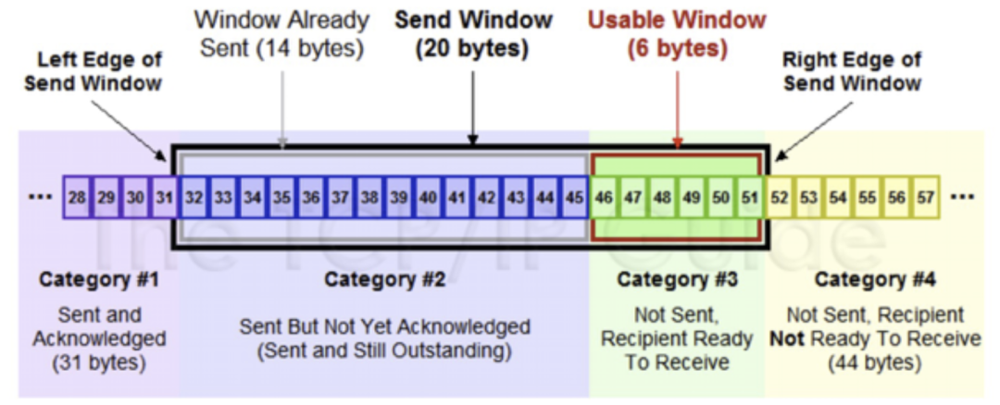

收到 36 的 ack，并发出了 46-51 的数据后，如下如所示：

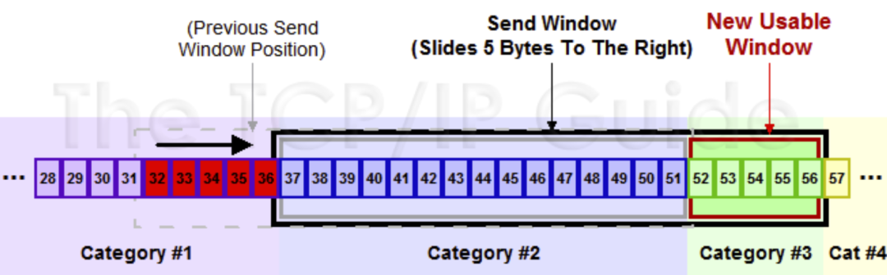

##### 滑动窗口的优化

默认的滑动窗口最大值只有 64 KB，通过在 Linux 下设置 **tcp_window_scaling** 为 1，可以提升滑动窗口的上限（最大值可高达 1GB），从而提升发送速度。

内核缓冲区决定了滑动窗口的上限，Linux 会对缓冲区动态调节，我们应该把缓冲区的上限设置为带宽时延积。缓冲区可分为：

- 发送缓冲区tcp_wmem 调节功能是自动打开的

- 接收缓冲区tcp_rmem 需要把 tcp_moderate_rcvbuf 设置为 1 来开启。

如果程序中的 socket 设置 **SO_SNDBUF** 和 **SO_RCVBUF**，则会关闭缓冲区的动态整功能，所以不建议在程序设置它俩，而是交给内核自动调整比较好。

##### 窗口关闭

如果接收方滑动窗口大小为0，就会阻止发送方给接收方传递数据，直到窗口变为非0为止，这就是**窗口关闭**。

接收方向发送方通告窗口大小时，是通过 ACK 报文来通告的。发生窗口关闭以后，如果接收方处理完数据向发送方通告一个窗口非0的 ACK 报文，会导致报文丢失，发送方接下来会一直等待接收方的非 0 窗口通知，接收方也一直等待发送方的数据，造成死锁。

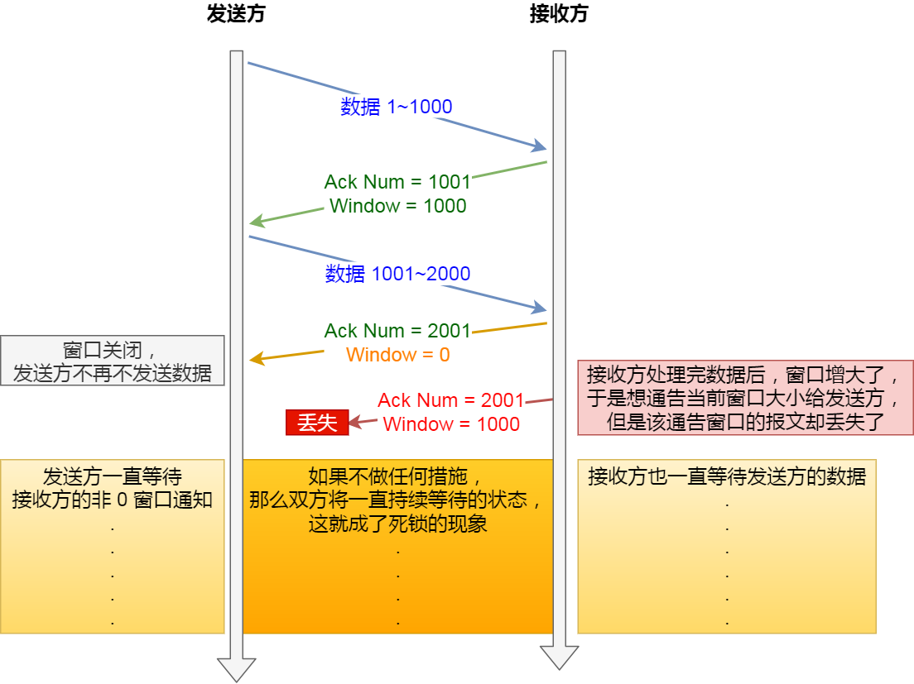

为了解决这个问题，TCP 为每个连接设有一个持续定时器，只要 TCP 连接一方收到对方的零窗口通知，就启动持续计时器。如果持续计时器超时，就会发送窗口探测 ( Window probe ) 报文，而对方在确认这个探测报文时，给出自己现在的接收窗口大小。

- 如果接收窗口仍然为 0，那么收到这个报文的一方就会重新启动持续计时器；

- 如果接收窗口不是 0，那么死锁的局面就可以被打破了。

窗口探测的次数一般为 3 次，每次大约 30-60 秒（不同的实现可能会不一样）。如果 3 次过后接收窗口还是 0 的话，有的 TCP 实现就会发 RST 报文来中断连接。

##### 窗口过小

如果接收方太忙了，来不及取走接收窗口里的数据，那么就会导致发送方的发送窗口越来越小。

**接收方**通常的策略：

当「窗口大小」小于min(MSS，缓存空间/2)时，就会向发送方通告窗口为 0，也就阻止了发送方再发数据过来。

**发送方**通常的策略：

使用 Nagle 算法，该算法的思路是延时处理，只有满足以下任一条件才可以发送数据：

- 窗口大小 >= MSS

- 数据大小 >= MSS

- 收到之前发送数据的 ack 回包

Nagle 算法默认是打开的，如果对于一些需要小数据包交互的场景的程序，比如，telnet 或 ssh 这样的交互性比较强的程序，则需要关闭 Nagle 算法。可以在 Socket 设置 **TCP_NODELAY** 选项来关闭这个算法。关闭 Nagle 算法没有全局参数，需要根据每个应用自己的特点来关闭。

#### 拥塞控制

目的：拥塞疏通

当网络拥塞时，减少数据的发送。

##### 包守恒原则

包守恒原则是拥塞控制的基础。TCP 维护一个发送窗口，估计当前网络链路上能容纳的数据包数量，希望在有数据可发的情况下，回来一个确认包就发出一个数据包，总是保持发送窗口那么多包在网络中流动。

传输的理想情况是要同时达到最大的吞吐量和最小的往返延迟，要达到这个目的，连接必须同时满足两个条件：

- 以链路瓶颈带宽BtlBw发包 （带宽利用率最高）

- 保证链路中没有缓存队列（延迟最低）

##### 慢启动算法

当拥塞控制窗口cwnd < 慢启动阈值ssthresh(slow start threshold)时，使用慢启动算法。

当发送方每收到一个 ACK，cwnd 的大小就会加 1。cwnd的值就随着网络往返时间(Round Trip Time,RTT)呈指数级增长。

慢启动对于大型流式下载服务的影响倒不显著，因为慢启动的时间可以分摊到整个传输周期内消化掉。但是由于限制了可用的吞吐量，对于小文件传输非常不利。

##### 拥塞避免算法

当拥塞控制窗口cwnd < 慢启动阈值ssthresh(slow start threshold)时，停止使用慢启动算法而改使用拥塞避免算法。

当拥塞窗口值大于慢启动门限时，停止使用慢启动算法而改用拥塞避免算法。拥塞避免算法使发送的拥塞窗口每经过一个往返时延RTT就增加一个MSS的大小。将原本慢启动算法的指数增长变成了线性增长，还处于增长阶段但是增长速度缓慢了一些。

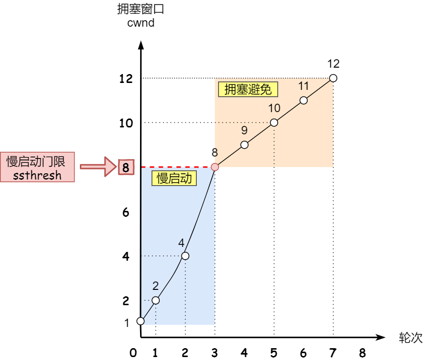

##### 拥塞发生算法

###### 超时重传

重传计时器超时的话，ssthresh 设为 cwnd/2，cwnd 重置为 1。重新开始慢启动。会突然减少数据流，容易造成网络卡顿。

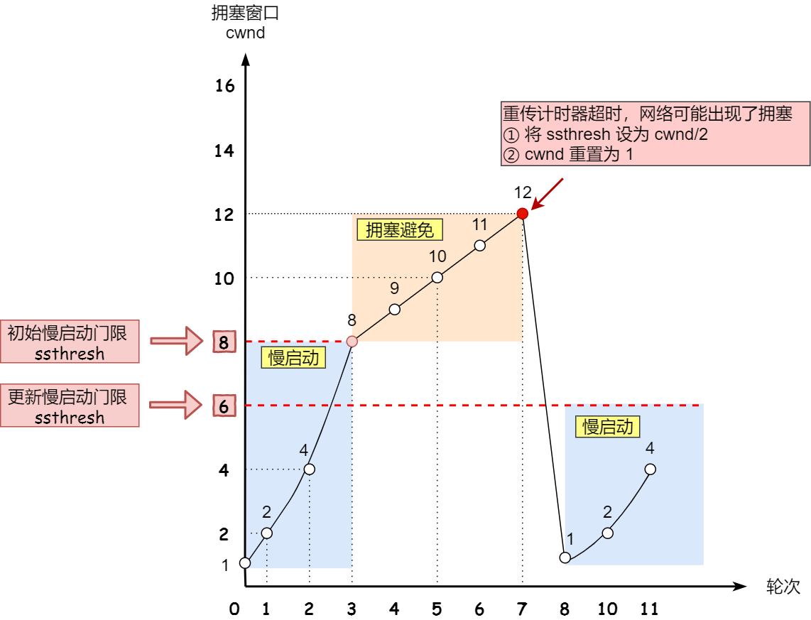

###### 快速重传

发送端只要一连收到3个重复的ACK, 即可断定有分组丢失了，ssthresh 设为 cwnd/2，cwnd 重置为 cwnd/2, 开始执行快速恢复算法。

##### 快速恢复算法

拥塞窗口 cwnd = ssthresh + 3 （ 3 的意思是确认有 3 个数据包被收到了）；

重传丢失的数据包；

如果再收到重复的 ACK，那么 cwnd 增加 1；

如果收到新数据的 ACK 后，把 cwnd 设置为第一步中的 ssthresh 的值，原因是该 ACK 确认了新的数据，说明从 duplicated ACK 时的数据都已收到，该恢复过程已经结束，可以回到恢复之前的状态了，也即再次进入**拥塞避免**状态；

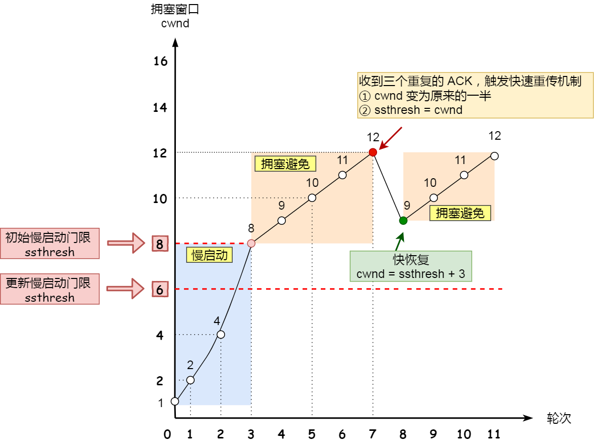

#### 停止等待协议

也是为了实现可靠传输的，它的基本原理就是每发完一个分组就停止发送，等待对方确认。在收到确认后再发下一个分组。

#### 重传机制

##### 超时重传

当TCP发出一个段后，它启动一个定时器，等待目的端确认收到这个报文段。如果不能及时收到一个确认，将重发这个报文段。

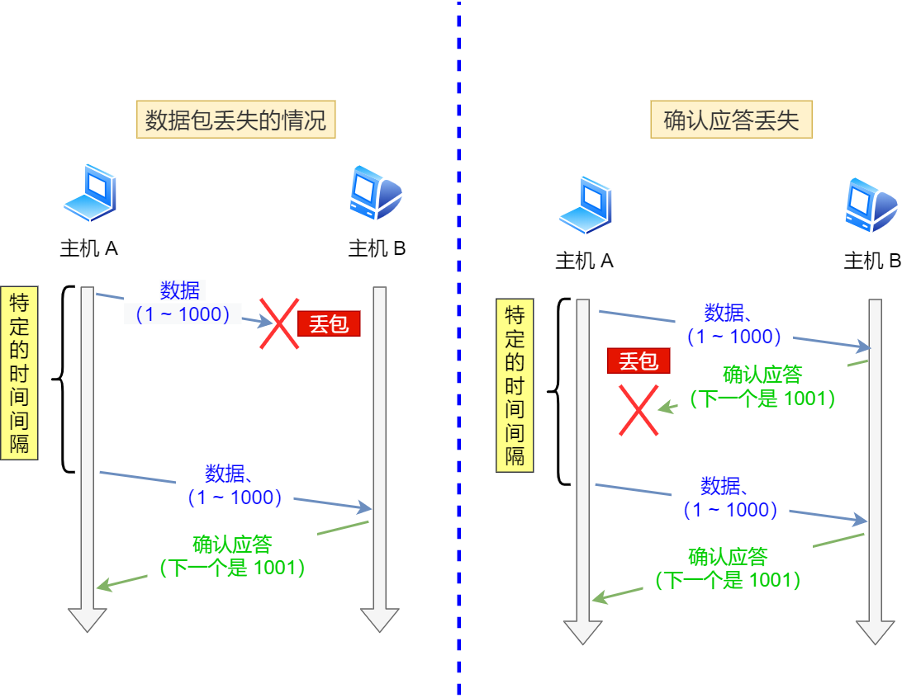

超时重传时间RTO的值应该略大于报文往返时间RTT的值。

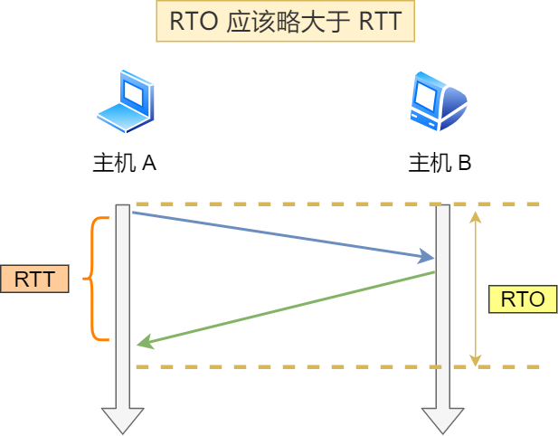

RFC6289建议使用如下公式计算RTO, 其中SRTT是计算平滑的RTT, DevRTR是计算平滑的RTT与最新RTT的差距。在Linux下μ = 1, ∂ = 4
$$
RTO=μ*SRTT+∂*DevRTT
$$
如果重传再度遇到超时，TCP的策略是将超时时间间隔设置为之前的两倍。

##### 快速重传

不以时间为驱动，而是以数据驱动重传。

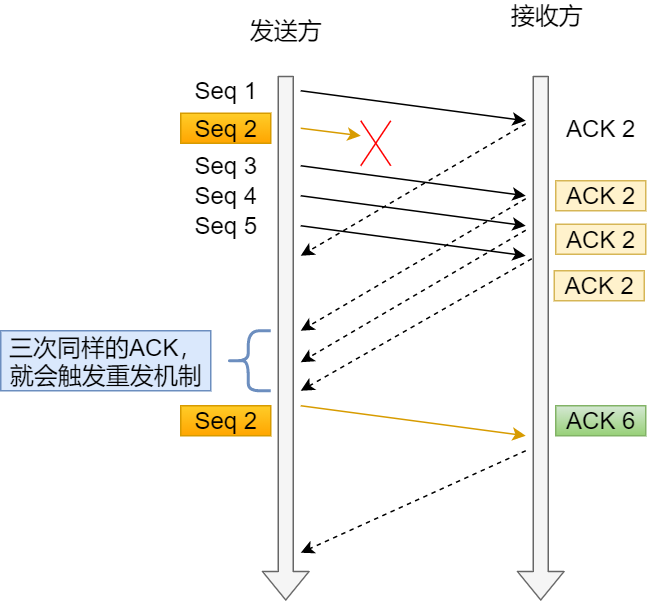

快速重传机制只解决了超时时间的问题，但是它依然面临着另外一个问题，就是重传的时候，是重传之前的一个还是重传所有的。

##### SACK

这种方式需要在TCP头部「选项」字段里加一个SACK(Selective Acknowledgment)的东西，这样发送方就可以通过查看ACK知道哪些数据收到了，哪些数据没收到。知道了这些信息，就可以只重传丢失的数据。

如果要支持 SACK，必须双方都要支持。在 Linux 下，可以通过 **net.ipv4.tcp_sack** 参数打开这个功能（Linux 2.4 后默认打开）。

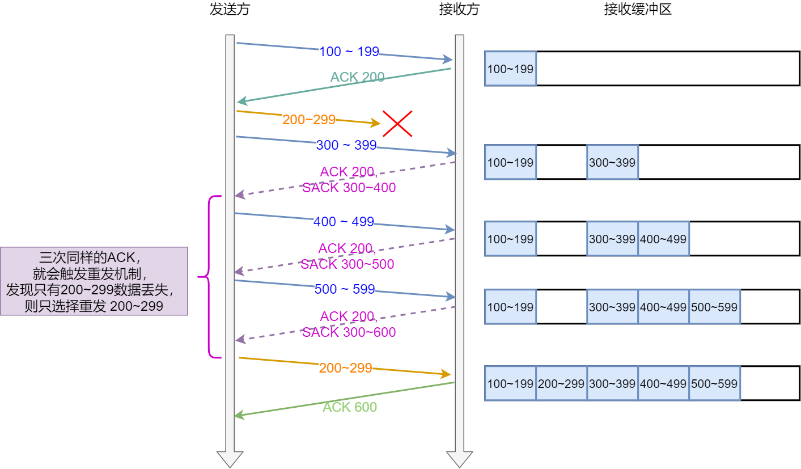

##### Duplicate SACK

Duplicate SACK 又称 D-SACK，其主要使用了 SACK 来告诉「发送方」有哪些数据被重复接收了。在 Linux 下可以通过 **net.ipv4.tcp_dsack** 参数开启/关闭这个功能（Linux 2.4 后默认打开）。

### 单工 半双工 双工

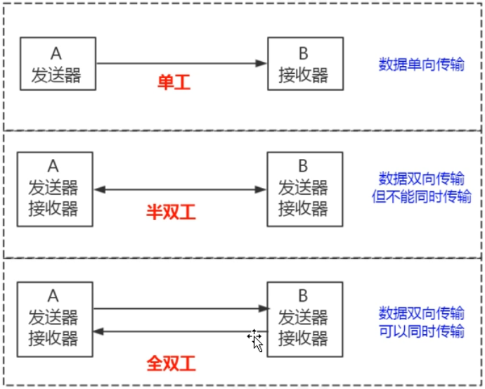

### 连接

连接，又称会话(session)，是虚拟、抽象的概念，能确保两个通信的程序彼此在线，加快响应请求速度，但是消耗更多资源。

### 报文格式

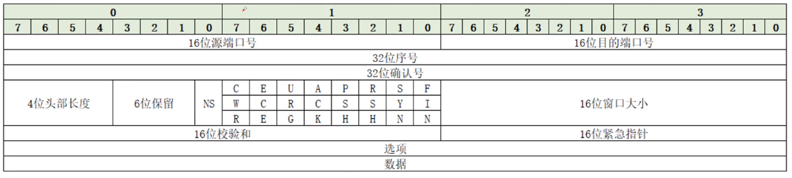

| 字段           | 长度   | 要点                                                         |
| -------------- | ------ | ------------------------------------------------------------ |
| 源端口/目的端口 | 各2字节 | 端口号加上IP地址共同构成socket；协议、源IP、源端口、目的IP、目的端口五元素唯一确定一个TCP连接。 |
| 发送序号seq     | 4字节  | 本报文段数据部分第一个字节的序号（每个字节都有序号）；建立连接时发送方将初始序号ISN填入。 |
| 接收序号ack     | 4字节  | 期望收到的下一个字节的序号=已成功收到的最后一个字节序号+1；ACK标志为1时有效，除主动发起连接的第一个TCP段外均设ACK。 |
| 数据偏移        | 4比特  | 数据开始处离TCP段起始处的距离，即TCP首部长度；以32位（4字节）为单位，故首部最大60字节。 |
| 保留位          | 6位    | 保留。                                                       |
| 控制位          | 按顺序9位 | NS/CWR/ECN为TCP扩展协议（ECN为拥塞控制协议，帮助解决延迟和丢包）；URG=1紧急指针有效；ACK=1确认号有效；PSH=1要求数据尽快交给应用程序；RST=1复位连接，一般在出错或关闭连接时使用；SYN同步位，SYN=1而ACK=0为连接请求报文，SYN=1且ACK=1为同意建立连接；FIN=1表示发送方完成数据发送。 |
| 窗口            | 2字节  | 发送方期望接收的字节数，可接收序号范围从确认号到确认号+窗口大小。 |
| 校验和          | 16bit  | Checksum把原文映射到不可逆的16bit编码，检查原文传输过程中是否发生变化。 |
| 紧急指针        | 2字节  | URG=1时有效，指出紧急数据最后一个字节的序号，使接收方知道紧急数据共有多长。 |
| 选项            | 可变   | 最常用最大段大小MSS，向对方通知本机可接收的最大TCP段长度，只在建立连接的请求中发送。 |

### TCP粘包&拆包

粘包拆包问题是处于网络比较底层的问题，在数据链路层、网络层以及传输层都有可能发生。

我们日常的网络应用开发大都在传输层进行，由于UDP有消息保护边界，不会发生粘包拆包问题，因此粘包拆包问题只发生在**TCP协议**中。

情况一：正常传输


情况二：粘包


情况三：粘包&拆包


#### 粘包原因

- 应用程序写入数据小于套接字缓冲区大小，网卡将应用多次写入的数据发送到网络上，这将会发生粘包。

- 接收方法不及时读取套接字缓冲区数据，这将发生粘包。

#### 拆包原因

- 应用程序写入的数据大于套接字缓冲区大小，这将会发生拆包。

- 进行MSS（最大报文长度）大小的TCP分段，当TCP报文长度-TCP头部长度>MSS的时候将发生拆包。

#### 解决方案

- 数据包添加首部，首部带有数据包的长度。

- 数据包封装为固定长度。

- 数据包之间设计边界。

### 三次握手

三次握手的目的是建立可靠的通信信道，说到通讯，简单来说就是数据的发送与接收，而三次握手最主要的目的就是双方确认自己与对方的发送与接收是正常的。

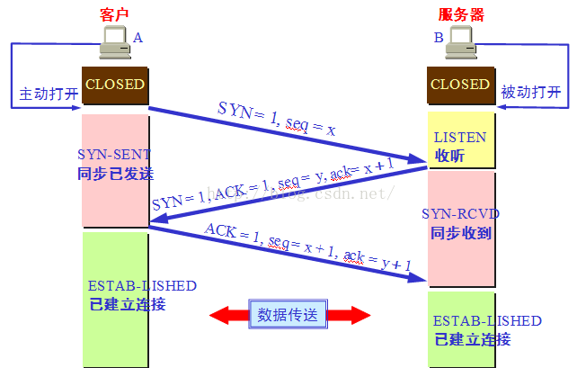

#### 第一次握手

(SYN=1, seq=x)

客户端–发送带有SYN标志(*Synchronize Sequence Numbers*)的数据包–一次握手–服务端

发送完毕后，客户端进入SYN_SENT状态。

Client什么都不能确认；

Server确认了对方发送正常。

##### 握手重传

前两次握手的超时重传规律相同：每次重传间隔翻倍（1、2、4、8、16 秒），第五次重传后再继续等待 32 秒，总耗时 1+2+4+8+16+32=63 秒，大约 1 分钟左右。

**第一次握手（客户端重传 SYN）**：正常情况下服务器会在几毫秒内返回 SYN+ACK，如果客户端长时间没有收到 SYN+ACK 报文，则会重发 SYN 包，重发次数由 tcp_syn_retries 参数控制，默认 5 次。

#### 第二次握手

(SYN=1, ACK=1, seq=y, ACKnum=x+1)

服务端–发送带有SYN/ACK标志的数据包–二次握手–客户端

发送完毕后，服务器端进入SYN_RCVD状态。

Client确认了：自己发送、接收正常，对方发送、接收正常；

Server确认了：自己接收正常，对方发送正常。

##### 第二次握手为什么要传回SYN？

接收端传回发送端所发送的 SYN 是为了告诉发送端，我接收到的信息确实就是你所发送的信号了。

##### 第二次握手为什么要传了SYN还要传ACK？

双方通信无误必须是两者互相发送信息都无误。传了 SYN，证明发送方到接收方的通道没有问题，但是接收方到发送方的通道还需要 ACK 信号来进行验证，目的是“为了防止已失效的连接请求报文段突然又传送到了服务端，因而产生错误”。

##### 第二次握手重传

服务端未收到 ACK 就会重发 SYN+ACK 报文并一直处于 SYN_RCV 状态，重传规律见上文「握手重传」，重发次数由 tcp_synack_retries 参数控制（默认 5 次）；当网络繁忙、不稳定、报文丢失严重时应该调大重发次数，反之则可以调小。

##### 为什么前两次握手不可以携带数据？

根据TCP协议的RFC793文档，带有SYN标志的过程包是不可以携带数据的，也就是说三次握手的前两次是不可以携带数据的（逻辑上看，连接还没建立，携带数据好像也有点说不过去）。

##### 半连接队列

TCP第二次握手后，服务端Linux内核就会建立一个“半连接队列”来维护未完成的握手信息。当半连接队列溢出后，服务端就无法再建立新的连接。

SYN攻击，攻击的是就是这个半连接队列。

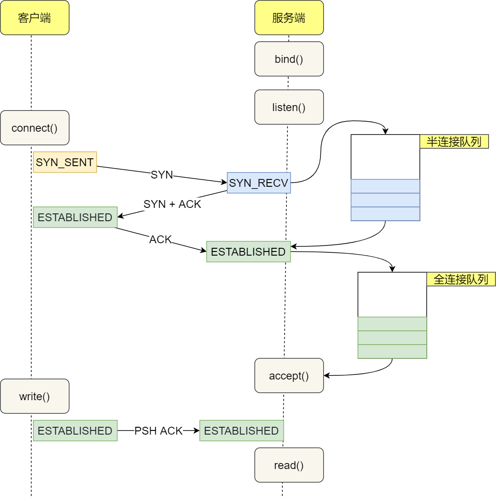

###### 查看失败

我们可以通过该netstat –s | grep "SYNs to LISTEN"命令查看由于SYN半连接队列已满引发的TCP连接失败次数。隔几秒执行几次，如果有上升的趋势，说明当前存在半连接队列溢出的现象。

###### 长度

要想增大半连接队列，不能只单纯增大tcp_max_syn_backlog的值，还需一同增大somaxconn和backlog, 也就是增大accept队列。

- somaxconn是Linux内核的参数，默认值是128，可以通过net.core.somaxconn来设置其值。

- backlog是listen(int sockfd, int backlog) 函数中的backlog大小。Tomcat, Nginx, Apache这些常见的Web服务的backlog默认值都是 511。

###### syncookies

开启syncookies功能就可以在不使用SYN半连接队列的情况下成功建立连接，工作原理是：服务器根据当前状态计算出一个值，放在己方发出的SYN+ACK报文中发出，当客户端返回ACK报文时，取出该值验证，如果合法，就认为连接建立成功。syncookies 参数主要有以下三个值：

- 0值，表示关闭该功能。

- 1值，表示仅当SYN半连接队列放不下时再启用它，设置成1即可应对SYN攻击。

- 2值，表示无条件开启功能。

#### 第三次握手

(ACK=1，ACKnum=y+1)

客户端–发送带有带有ACK标志的数据包–三次握手–服务端

发送完毕后，客户端进入ESTABLISHED状态，当服务器端接收到这个包时，也进入ESTABLISHED状态，即可以开始数据传输。

Client确认了：自己发送、接收正常，对方发送、接收正常；

Server确认了：自己发送、接收正常，对方发送接收正常。

##### 为什么第三次握手可以携带数据？

根据TCP协议的RFC793文档，“Data or controls which were queued for transmission may be included”，也就是说标准表示，第三次握手的ACK包是可以携带数据。

##### 全连接队列

服务器收到 ACK 后连接建立成功，此时，内核会把连接从半连接队列移除，然后创建新的完全的连接，并将其添加到全连接队列（accept队列），等待进程调用accept函数时把连接取出来。

如果进程不能及时地调用就会造成全连接队列溢出，最终导致建立好的TCP连接被丢弃。

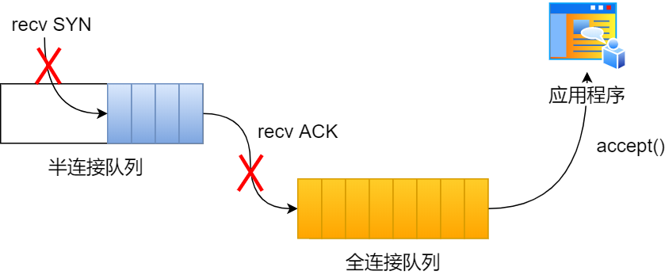

###### 查看失败

我们可以使用netstat –s | grep overflowed命令来查看全连接队列溢出导致丢失的TCP连接个数。如果持续不断地有连接因为accept队列溢出被丢弃，就应该调大backlog以及somaxconn参数。

###### 长度

accept队列的长度取决于min(somaxconn, backlog)。

可以通过ss -ltn命令查看：

- Recv-Q：当前全连接队列的大小，也就是当前已完成三次握手并等待服务端accept()的TCP连接。

- Send-Q：全连接队列最大长度。

###### RST复位

丢弃连接只是Linux的默认行为，我们还可以选择向客户端发送RST复位报文告诉客户端连接已经建立失败。tcp_abort_on_overflow参数共有两个值：

| 参数值 | 执行逻辑                                                     | 备注                                                         |
| ------ | ------------------------------------------------------------ | ------------------------------------------------------------ |
| 0      | 如果全连接队列满了，那么server扔掉client发过来的ack.         | 通常情况下应当设置为0，更有利于应对突发流量。                |
| 1      | 如果全连接队列满了，server发送一个RST包给client, 表示废掉这个握手过程和这个连接。 | 打开这一功能需要将tcp_abort_on_overflow参数设置为1，全连接队列溢出会有很多connection reset by peer错误出现的现象。 |

#### 如何绕过三次握手？

三次握手建立连接造成的后果就是，HTTP 请求必须在一个 RTT（从客户端到服务器一个往返的时间）后才能发送。在 Linux 3.7 内核版本之后，提供了 **TCP Fast Open** 功能，这个功能可以减少 TCP 连接建立的时延。

在 Linux 系统中，可以通过设置 tcp_fastopn 内核参数，来打开 Fast Open 功能：

| tcp_fastopn的值 | 意义                                                |
| --------------- | --------------------------------------------------- |
| 0               | 关闭                                                |
| 1               | 作为客户端使用 Fast Open 功能                       |
| 2               | 作为服务端使用 Fast Open 功能                       |
| 3               | 无论作为客户端还是服务器，都可以使用 Fast Open 功能 |

TCP Fast Open 功能需要客户端和服务端同时支持，才有效果。

##### 首次建立连接

- 客户端发送 SYN 报文，该报文包含 Fast Open 选项，且该选项的 Cookie 为空，这表明客户端请求 Fast Open Cookie；

- 支持 TCP Fast Open 的服务器生成 Cookie，并将其置于 SYN-ACK 数据包中的 Fast Open 选项以发回客户端；

- 客户端收到 SYN-ACK 后，本地缓存 Fast Open 选项中的 Cookie。

所以第一次发起 HTTP GET 请求的时候，还是需要正常的三次握手流程。

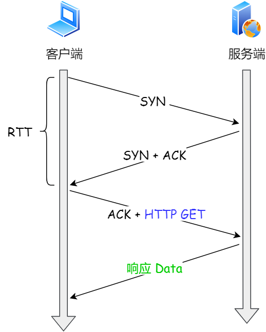

##### 再次建立连接时

- 客户端发送 SYN 报文，该报文包含「数据」（对于非 TFO 的普通 TCP 握手过程，SYN 报文中不包含「数据」）以及此前记录的 Cookie；

- 支持 TCP Fast Open 的服务器会对收到 Cookie 进行校验：
  - 如果 Cookie 有效，服务器将在 SYN-ACK 报文中对 SYN 和「数据」进行确认，服务器随后将「数据」递送至相应的应用程序；
  - 如果 Cookie 无效，服务器将丢弃 SYN 报文中包含的「数据」，且其随后发出的 SYN-ACK 报文将只确认 SYN 的对应序列号；

- 如果服务器接受了 SYN 报文中的「数据」，服务器可在握手完成之前发送「数据」，这就减少了握手带来的 1 个 RTT 的时间消耗；

- 客户端将发送 ACK 确认服务器发回的 SYN 以及「数据」，但如果客户端在初始的 SYN 报文中发送的「数据」没有被确认，则客户端将重新发送「数据」；

- 此后的 TCP 连接的数据传输过程和非 TFO 的正常情况一致。

之后发起 HTTP GET 请求的时候，可以绕过三次握手，这就减少了握手带来的 1 个 RTT 的时间消耗。

#### 三次握手的优化

即前述五节考点的回指清单：客户端 SYN 重传由 **tcp_syn_retries** 控制；半连接队列溢出用 netstat -s 观察并由 **tcp_max_syn_backlog**/**somaxconn**/**backlog** 调大，遭 SYN 攻击时设 **tcp_syncookies** 为 1；服务端 SYN+ACK 重传由 **tcp_synack_retries** 控制；accept 队列溢出由 **tcp_abort_on_overflow**（置 1 改发 RST 通知）处理，队列长度取决于 min(**backlog**, **somaxconn**)；绕过握手用 TCP Fast Open（**tcp_fastopen**，需客户端和服务端同时支持）。

### 四次挥手

任何一方都可以在数据传送结束后发出连接释放的通知，待对方确认后进入**半关闭状态**。在这一期间，主动关闭方依然可以接收来自对面的数据。当另一方也没有数据再发送的时候，则发出连接释放通知，对方确认后就完全关闭了TCP连接，共计四次。

*举个例子：A 和 B 打电话，通话即将结束后，A 说“我没啥要说的了”，B回答“我知道了”，但是 B 可能还会有要说的话，A 不能要求 B 跟着自己的节奏结束通话，于是 B 可能又巴拉巴拉说了一通，最后 B 说“我说完了”，A 回答“知道了”，这样通话才算结束。*

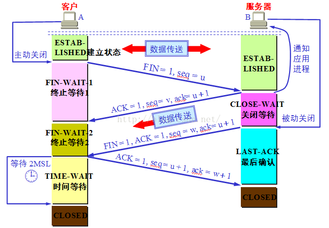

#### 第一次挥手

(FIN=1，seq=a)

客户端-发送一个FIN，用来关闭客户端到服务器的数据传送。

发送完毕后，客户端进入FINWAIT1状态。

#### 第二次挥手

(ACK=1，ACKnum=a+1)

服务器-收到这个FIN，它发回一个ACK，**确认序号**为收到的序号加1。和SYN一样，一个FIN将占用一个序号。发送完毕后，服务器端进入CLOSEWAIT状态。

客户端接收到这个确认包之后，连接状态由 FIN_WAIT1 变为 FIN_WAIT2，也就是表示主动方的发送通道就关闭了。。

#### 第三次挥手

(FIN=1，seq=b)

服务器-关闭与客户端的连接，发送一个FIN给客户端。

发送完毕后，服务器端进入LAST_ACK 状态，等待来自客户端的最后一个ACK。

##### 为什么四次挥手比三次握手多一次？

因为第二次握手ACK+SYN相当于把第二次挥手ACK和第三次挥手FIN合并了。

#### 第四次挥手

 (ACK=1，ACKnum=b+1)

客户端-发回ACK报文确认，并将**确认序号**设置为收到的序号加1。

客户端接收到来自服务器端的关闭请求，发送一个确认包，并进入TIME_WAIT状态，等待了2MSL(最大段生命周期Maximum Segment Lifetime, 任何报文在网络上存在的最长时间，超过这个时间报文将被丢弃)，在Linux系统下大约一分钟之后，没有收到服务器端的ACK，认为服务器端已经正常关闭连接，于是自己也关闭连接，进入CLOSED状态。

服务器端接收到这个确认包之后，关闭连接，进入CLOSED状态。主动关闭连接的才有TIME_WAIT状态，所以服务端没有这个状态。

##### 为什么在主动关闭方第三次挥手后的TIME-WAIT状态必须等待2MSL的时间？

第一，为了保证A发送的最后一个ACK报文能够到达B。

这个ACK报文段有可能丢失，因而使处在LAST-ACK状态的B收不到对已发送的FIN+ACK报文段的确认。B会超时重传这个FIN+ACK报文段，而A就能在2MSL时间内收到这个重传的FIN+ACK报文段。

如果A在TIME-WAIT状态不等待一段时间，而是在发送完ACK报文段后就立即释放连接，就无法收到B重传的FIN+ACK报文段，因而也不会再发送一次确认报文段。这样，B就无法按照正常的步骤进入CLOSED状态。

第二，A在发送完ACK报文段后，再经过2MSL时间，就可以使本连接持续的时间所产生的所有报文段都从网络中消失。这样就可以使下一个新的连接中不会出现这种旧的连接请求的报文段。

#### 四次挥手的优化

##### 主动方的优化

主动发起 FIN 报文断开连接的一方，如果迟迟没收到对方的 ACK 回复，则会重传 FIN 报文，重传的次数由 **tcp_orphan_retries** 参数决定。

当主动方收到 ACK 报文后，连接就进入 FIN_WAIT2 状态，根据关闭的方式不同，优化的方式也不同：

- 如果这是 **close** 函数关闭的连接，那么它就是孤儿连接。如果 tcp_fin_timeout 秒内没有收到对方的 FIN 报文，连接就直接关闭。同时，为了应对孤儿连接占用太多的资源，tcp_max_orphans 定义了最大孤儿连接的数量，超过时连接就会直接释放。

- 反之是 **shutdown** 函数关闭的连接，则不受此参数限制；

当主动方接收到 FIN 报文，并返回 ACK 后，主动方的连接进入 TIME_WAIT 状态。这一状态会持续 1 分钟，为了防止 TIME_WAIT 状态占用太多的资源，**tcp_max_tw_buckets** 定义了最大数量，超过时连接也会直接释放。

当 TIME_WAIT 状态过多时，还可以通过设置 **tcp_tw_reuse** 和 **tcp_timestamps** 为 1 ，将 TIME_WAIT 状态的端口复用于作为客户端的新连接，注意该参数只适用于客户端。

##### 被动方的优化

被动关闭的连接方应对非常简单，它在回复 ACK 后就进入了 CLOSE_WAIT 状态，等待进程调用 close 函数关闭连接。因此，出现大量 CLOSE_WAIT 状态的连接时，应当从应用程序中找问题。

当被动方发送 FIN 报文后，连接就进入 LAST_ACK 状态，在未等到 ACK 时，会在 **tcp_orphan_retries** 参数的控制下重发 FIN 报文。

##### 排查命令：先看规模，再定参数

遇到 CLOSE_WAIT 或 TIME_WAIT 异常堆积，先用 `ss` 看规模与归属，而不是一上来就调内核复用参数：

```shell
ss -s                        # 连接统计总览
ss -tanp state close-wait    # CLOSE_WAIT 的规模、对端地址与 PID
ss -tanp state time-wait     # TIME_WAIT 的规模与端口
```

CLOSE_WAIT 堆积基本指向应用没有及时 close：对照连接池配置、业务线程栈。TIME_WAIT 多只说明主动关闭方多、短连接高频，先看关闭方角色与连接生命周期，量大不一定是故障。

## UDP协议

UDP的全称是User Datagram Protocol, 用户数据报协议。它**不需要**所谓的握手操作建立连接，从而**加快**了通信速度，以封装的原始IP数据报为传输单元进行数据传输的不可靠的连接。

### 特点

- UDP能够支持容忍数据包丢失的带宽密集型应用程序

- UDP具有低延迟的特点

- UDP能够发送大量的数据包

- UDP能够允许DNS查找，DNS是建立在UDP之上的应用层协议。

### 为什么不能跳过UDP直接调用IP协议？

不能直接调用IP协议因为IP协议只能把数据从一个网络接口发送到另一个网络接口，无法寻址到应用。

### 报文格式

设计目标：在允许用户直接发送报文的情况下，最大限度简化应用设计。

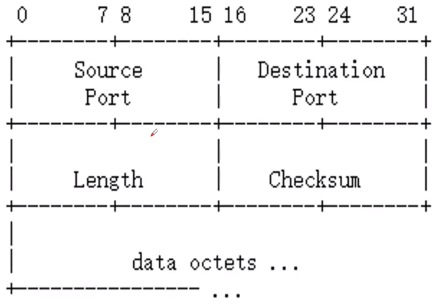

| 字段             | 含义                      |
| ---------------- | ------------------------- |
| Source Port      | 源端口号                  |
| Destination Port | 目标端口号                |
| Length           | 消息体长度                |
| Checksum         | 检查封包是否出错          |
| Data octets      | 以字节(8-bit)为单位的数据 |

## TCP VS UDP

|            | TCP                                                          | UDP                                                          |
| ---------- | ------------------------------------------------------------ | ------------------------------------------------------------ |
| 本质       | 提供可靠的网络传输。                                         | 提供报文交换，简化协议。                                     |
| 可靠性     | TCP 提供可靠交付的服务，通过TCP连接传送的数据，无差错、不丢失、不重复、并且按序到达。 | UDP 使用尽最大努力交付，即不保证可靠交付，因此主机不需要维持复杂的链接状态（这里面有许多参数）。 |
| 数据包排序 | 数据包会按照特定的顺序排列。                                 | 数据包没有固定顺序，之间相互独立。                           |
| 连接对象   | 支持一对一的交互通信。                                       | 支持一对一、一对多、多对一和多对多的交互通信。               |
| 面向连接   | TCP提供**面向连接**的数据流传输，数据传输前必须先建立连接。  | UDP提供的是**面向报文**、非面向连接的数据流传输，允许建立连接前就开始传输数据。 |
| 量级       | 重量级，传输数据前先三次握手建立连接。                       | 轻量级，没有跟踪连接、消息排序等。                           |
| 传输单位   | 虽然应用程序和 TCP 的交互是一次一个数据块（大小不等），但 TCP 把应用程序交下来的数据仅仅看成是一连串的无结构的字节流。  TCP传输单位称为TCP报文段。 | UDP传输单位称为用户数据报。                                  |
| 传输速度   | TCP注重数据安全性，数据传输更慢。                            | UDP数据传输快，因为不需要连接等待少了许多操作，但其安全性却一般。 |
| 头部字节   | TCP的首部开销大，有20个字节。                                | UDP的首部开销小，只有8个字节。                               |
| 错误校验   | 会进行错误校验并能够进行错误恢复。                           | 会进行错误检查但会丢弃错误的数据包。                         |
| 发送确认   | 有发送确认。                                                 | 没有发送确认。                                               |
| 握手协议   | 有握手协议。                                                 | 没有握手协议。                                               |
| 拥塞控制   | 有拥塞控制。                                                 | 没有拥塞控制，因此网络出现拥塞不会使源主机的发送速率降低（对实时应用很有用，如  直播，实时视频会议等）。 |
| 应用层协议 | SMTP应用：电子邮件  TELNET应用：远程终端接入  HTTP (3.0以下)应用：万维网  FTP应用：文件传输 | DNS应用：域名转换  TFTP应用：文件传输  SNMP应用：网络管理  NFS应用：远程文件服务器  HTTP 3.0应用：万维网 |

## 端口

由16位整数组成。TCP端口和UDP端口是分开的，均有65535个端口。

- 公认端口 0-1023 紧密绑定特定服务

- 注册端口 1024-49151 建议使用

- 动态/私有端口 49152-65535 程序使用的动态端口

常用端口（TCP和UDP）默认如下：

- HTTP端口 80
- HTTPS端口 443

- MySQL端口 3306
- Tomcat端口 8080

