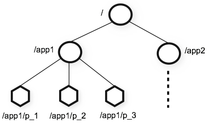
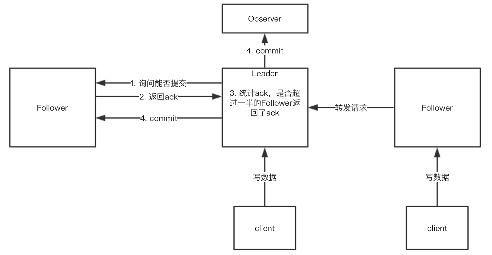
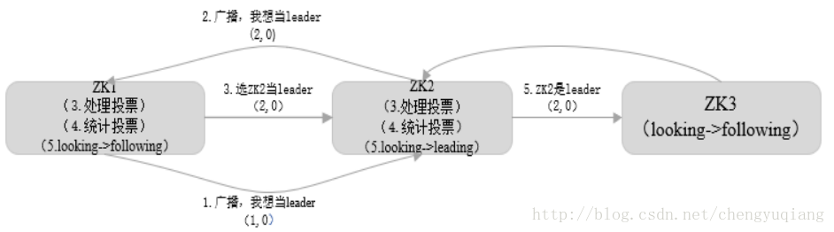
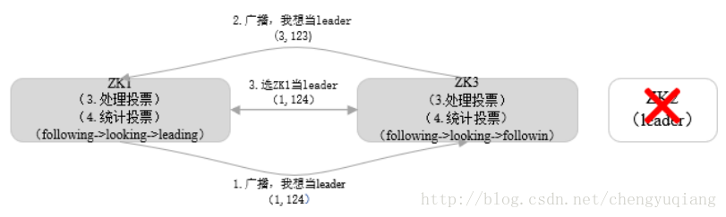
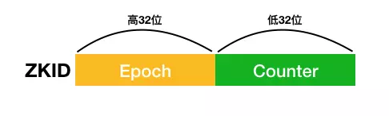
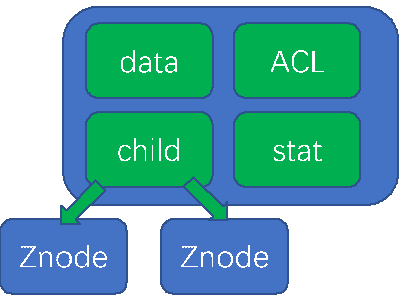
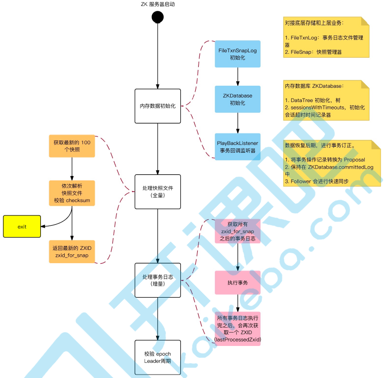

# SYS3013 — ZooKeeper

返回[Bulletin](./bulletin.md)

返回[SYS301 — Distributed Systems](./SYS301.md)

[TOC]

## 1. Positioning（定位）

常见误区：把 ZooKeeper 定位为“解决了数据一致性问题的分布式数据库”——不准确：

**ZooKeeper is a distributed coordination service（分布式协调服务）**。它通过 ZAB 协议保证内部数据的强一致，但它存在的目的不是存储业务数据，而是**维护协调所需的少量元数据**：

- 配置 configuration

- 成员关系 membership

- Leader 选举结果

- 分布式锁

- 命名 naming

每个 znode 数据上限 1MB——它从设计上就不是通用数据库，也不是消息队列。

即使现代 Kafka 已用 KRaft 去掉 ZooKeeper 依赖，ZooKeeper 对理解 coordination、membership、leader election、distributed lock，以及大量仍在生产运行的真实系统（HBase、Dubbo 注册中心、BigPipe 这类历史架构）仍然是必修课。

## 2. Data Model（数据模型）

### 文件系统

Zookeeper提供一个多层级的节点命名空间。



#### Znode

ZooKeeper的节点被称为Znode，为了保证高吞吐和低延迟，每个节点的存放数据上限为1M。

完整的 Znode 属性表（cZxid / mZxid / pZxid / version 系列…）见 Appendix。

#### 常用的API 

- create创建节点

- delete删除节点

- exists判断节点是否存在

- getData获得一个节点的数据

- setData设置一个节点的数据

- getChildren获取节点下的所有子节点

- sync 等待数据被传播

#### Znode的类型

##### PERSISTENT 持久化目录节点

客户端与zookeeper断开连接后，该节点依旧存在。

##### PERSISTENT_SEQUENTIAL 持久化顺序编号目录节点

客户端与zookeeper断开连接后，该节点依旧存在，只是Zookeeper给该节点名称进行顺序编号

##### EPHEMERAL 临时目录节点

客户端与zookeeper断开连接后，该节点被删除

##### EPHEMERAL_SEQUENTIAL 临时顺序编号目录节点

客户端与zookeeper断开连接后，该节点被删除，只是Zookeeper给该节点名称进行顺序编号

## 3. Session（会话）

Client、Session、Ephemeral Node 的三层关系：

```
Client ── TCP Connection（断了可以重连）──> ZooKeeper Ensemble
   └──── Session（sessionId + timeout）
              └──── Ephemeral ZNode 的生命周期绑定在 Session 上
```

三个概念必须分清：

- **TCP Connection**：物理连接，断了可以重连，甚至可以换一台机器连。

- **Session**：逻辑会话。连接断开 session 不一定立即失效——在 session timeout 内重连上，session 继续有效；超时仍未恢复，session 才结束。

- **Ephemeral Node**：生命周期 = Session 的生命周期。session 结束（超时或 close），它创建的所有临时节点被自动删除。

Session 是 ZooKeeper 一切协调语义的基础：

- **Membership 成员管理**：成员下线 ⇔ session 过期 ⇔ 临时节点消失 ⇔ 其他人收到 Watch 通知。

- **Service Registration 服务注册**：注册 = 创建临时节点；宕机自动注销。

- **Leader Election**：见第 6、7 节。

- **Distributed Lock**：锁的故障自动释放，靠的就是 session 过期删临时节点（SYS3015）。

## 4. Watch（通知机制）

客户端可以对某个Znode建立一个**Watcher**监听器事件。当Znode发生改变，也就是调用了create，delete，setData方法的时候，将会触发Znode上注册的对应事件，请求Watch的客户端会接收到异步通知。

常见的监听场景有以下两项：

- 监听Znode节点的数据变化

- 监听子节点的增减变化

服务端在生成WatchedEvent事件之后，会调用getWrapper方法将自己包装成一个可序列化的Watch**er**Event事件，以便通过网络传输到客户端。客户端在接收到服务端的这个事件对象后，首先会将Watch**er**Event还原成一个Watch**ed**Event事件，并传递给process(Watch**ed**Event event)方法处理，回调方法process根据三个入参：通知状态（Enum keeperState）、事件类型（Enum EventType）和节点路径（String path）就能够解析出完整的服务端事件了。

无论是WatchedEvent还是WatcherEvent，都是对ZooKeeper服务端事件的简单封装。不同的是，WatchedEvent是一个逻辑事件，用于服务端和客户端程序执行过程中所需的逻辑对象，而WatcherEvent因为实现了序列化接口，可以用于网络传输。

### 纠偏：Watch 是通知机制，不是 MQ

- Watch（经典语义下）是**一次性**的：触发后失效，客户端要**重新注册**才能继续监听。

- 收到通知只说明“这个节点变了”，**客户端必须重新读取真实状态**（getData / getChildren）才能知道变成了什么。

- 通知可能合并、可能只反映最新状态而非每一个中间变化，所以不能把 Watch 当消息队列用。

## 5. Coordination Use Cases（协调场景）

#### 配置管理

（文件系统、通知机制）

程序分布式的部署在不同的机器上，将程序的配置信息放在zk的znode下，当有配置发生改变时，也就是znode发生变化时，可以通过改变zk中某个目录节点的内容，利用watcher通知给各个客户端，从而更改配置。

#### 集群管理

（文件系统、通知机制）

所谓集群管理无在乎两点：

- 是否有机器退出和加入

- 选举master

对于第一点，所有机器约定在父目录下创建临时目录节点，然后监听父目录节点的子节点变化消息。一旦有机器加入/挂掉，该机器与 zookeeper的连接建立/断开，其所创建的临时目录节点被添加/删除，所有其他机器都收到通知。

对于第二点，我们稍微改变一下，所有机器创建临时顺序编号目录节点，每次选取编号最小的机器作为master就好。

#### 命名服务

（文件系统）

命名服务是指通过指定的名字来获取资源或者服务的地址，利用zk创建一个全局的路径，即是唯一的路径，这个路径就可以作为一个名字，指向集群中的集群，提供的服务的地址，或者一个远程的对象等等。

#### Leader Election

选举 master：同上面“集群管理”第二点——临时顺序编号目录节点、取编号最小者；选举状态机与 PK 规则详见第 7 节。

#### 分布式锁

详见 SYS3015《Distributed Lock》——EPHEMERAL_SEQUENTIAL + watch predecessor 的经典模型。

## 6. ZAB协议

ZAB协议（ZooKeeper Atomic Broadcast protocol）是ZooKeeper专门设计的支持崩溃恢复的原子广播协议。这个机制保证了各个Server之间的同步以及各个节点之间的数据一致性。

要点：

- **Leader / Follower**：所有写请求由 Leader 统一处理（Follower 收到写请求会转发给 Leader）。

- **Proposal**：每个事务作为一个 Proposal 从 Leader 广播出去。

- **ZXID**：64 位事务 ID（高 32 位 epoch + 低 32 位 counter），全局单调递增——**Ordered Transaction** 的保证。

- **Quorum**：过半 Follower ACK 后 Leader 才 commit——多数派的意义见 SYS3011 第 7 节。

- **Crash Recovery**：Leader 崩溃后进入恢复模式，重新选举 + 同步（见下）。

### ZAB VS Paxos

ZAB协议非常类似于一致性算法Paxos和Raft. 很多人会误以为ZAB协议是Paxos的一种特殊实现，事实上他们是两种不同的协议。

- ZAB主要是为分布式主备系统设计的，提交事务并不像2PC一样需要全部follower都ACK，只需要得到超过半数的节点的ACK就可以通过。

- Paxos的实现是一致性状态机(state machine replication)。

### 广播模式（Broadcast）

广播模式进行状态同步保证了leader和Server具有相同的系统状态。

ZAB协议既不是强一致性，也不是弱一致性，而是处于两者之间的**单调一致性**。它依靠事务ID和版本号，保证了数据的更新和读取是有序的。



0. leader从客户端或者从Follower收到一个转发自客户端的写请求，生成一个新的事务并为这个事务生成一个唯一的ZXID.

1. leader将这个事务发送给所有的follows节点（预提交）

2. follower节点将收到的事务请求加入到**历史队列**(history queue)中，写下事务日志，然后发送ack给leader

3. Leader统计收到的ack是否过半。当leader收到过半follower返回的ack消息后，会写下事务日志，然后向Follower和Obeserver发送commit请求。

4. 当follower收到commit请求时，会判断该事务的ZXID是不是比历史队列中的任何事务的ZXID都小，如果是则提交，如果不是则等待比它更小的事务的commit.

补充：ZooKeeper 的写全部经 Leader 排序，是强一致的；但**默认读 Follower 可能读到旧数据**，要保证读到最新需要先 sync()。

### 恢复模式（Recovery）

当服务启动或者在领导者崩溃后，ZAB就进入了恢复模式，当领导者被选举出来，且大多数Server完成了和 leader的状态同步以后，恢复模式就结束了。

恢复模式内的选举与同步流程见第 7 节。

## 7. Leader Election & Quorum

### 节点的选举状态

- LOOKING：寻找Leader状态，处于该状态需要进入选举流程
- LEADING：领导者状态，处于该状态的节点说明是角色已经是**leader**
- FOLLOWING：跟随者状态，表示Leader已经选举出来，当前节点角色是**follower**
- OBSERVER：观察者状态，表明当前节点角色是**observer**

### 选举流程

触发条件1：在集群初始化阶段，当有一台服务器Server1启动时，该Server1处于Looking状态，其单独无法进行和完成Leader选举；当第二台服务器Server2启动时，此时两台机器可以相互通信，每台机器都试图找到Leader，于是进入Leader选举过程。



触发条件2：在Zookeeper运行期间，Leader与Follower服务器各司其职，即便有Follower服务器宕机或新Follower加入，此时也不会影响Leader，但是一旦发生以下情况之一就会再度引发选举：

- Leader服务器挂了；

- Leader发现follower挂得只剩不过半的follower存活并跟随自己。

 

每个服务器发出一个投票。初始情况Server1和Server2都会将自己作为Leader服务器来进行投票，每次投票会包含所推举的服务器的myid和ZXID，使用(myid, ZXID)来表示。

- myid: 集群中服务器的唯一标识。例如：有三个zk 服务器，那么编号分别是1,2,3。

- ZXID: 是一个64位的数字，由Leader统一分配，全局唯一，不断递增，所以数字越大代表操作越新、越接近现在。因为递增，ZXID可以保证事务的顺序一致性。ZXID由两部分组成：
  - 高32位的纪元号(epoch) 在当前leader当选的时候生成，递增。也被称为逻辑时钟(Logicalclock)。
  - 低32位表示计数器(counter) 在当前ZK节点执行事务性请求的时候生成，递增。



每个服务器接收来自各个服务器的投票。首先判断该投票的有效性，如检查是否是本轮投票、是否来自LOOKING状态的服务器。

每个服务器处理投票。针对每一个投票，服务器都需要将别人的投票和自己的投票进行PK，PK规则如下：

- ZXID比较大（数据比较新），服务器优先作为Leader服务器。

- ZXID一致，myid较大的服务器优先作为Leader服务器。

统计投票：一旦有过半机器接受到相同的投票信息，该投票对应的机器即成为 Leader；随后每个服务器更新自己的状态——是Follower就变更为FOLLOWING，是Leader就变更为LEADING。

### 为什么 Majority

- 任意两个多数派必然有交集（见 SYS3011 第 7 节），所以同一时刻不可能选出两个都“有效”的 Leader。

- 选举时优先比较 ZXID：数据最新的节点胜出，保证旧 Leader 已提交的事务不会在新任期丢失。

### 为什么通常部署奇数台（voting members）

Zookeeper集群一大特性是只要**大于一半**的节点存活，集群就可以正常提供服务。以 3 台 vs 4 台对比即可看清规律：

- 3 台：半数以上最少 2 台，允许挂 1 台；4 台：半数以上最少 3 台，同样只允许挂 1 台——容灾能力相同，4 台成本更高。

- 规则：2n+1 台与 2n+2 台容灾能力相同（都允许 n 台机器宕机），本着节约宗旨一般部署奇数台。反例是 2 台：至少 2 台运行，一台都不允许挂。

### Discovery / Synchronization

#### Discovery 发现阶段

Follower跟准Leader进行通信，如果认错准Leader，连接会被拒绝，ZooKeeper会进入重新选举阶段。连接建立后，Follower将最大的zxid发送给准Leader.

#### Synchronization 同步阶段

准Leader根据Follower的zxid确定同步点，同步集群中所有的副本。Follower只会接收zxid比自己的lastZxid大的提议。全部完成后，准Leader才会成为正式Leader, 成为uptodate状态。

Follower收到uptodate消息后，可以开始接受client的请求进行服务。

## 8. Split Brain（脑裂）

脑裂出现的原因是一部分服务器和领导失去了连接，而这一部分服务器之间是可以相互连通的，所以这一部分服务器会重新选举，如果重新选举出来了一个Leader，那么整个集群就出现了两个Leader，这就是脑裂。脑裂后数据的修复合并非常困难。

过半机制的验证可以避免脑裂发生。Zookeeper中的领导者选举需要收到超过一半的服务器的选票，所以服务器的节点数量是不足以达成脑裂的。

更严谨的表述：过半机制保证的是**少数派分区无法形成有效 quorum**——少数派既选不出能提交事务的 Leader，也无法对外提供写服务，因此不会出现“两边都能写”的双主脑裂；代价是少数派分区整体不可用，这正是 CAP 里选 C 弃 A 的体现（SYS3011 第 3 节）。

## Appendix — ZooKeeper Operations

### Znode 属性表

Znode可以设置的数据如下：

| **节点属性**   | **注解**                                                     |
| -------------- | ------------------------------------------------------------ |
| cZxid          | 该数据节点被创建时的事务Id                                   |
| mZxid          | 该数据节点被修改时最新的事物Id                               |
| pZxid          | 当前节点的父级节点事务Id                                     |
| ctime          | 该数据节点创建时间                                           |
| mtime          | 该数据节点最后修改时间                                       |
| dataVersion    | 当前节点版本号（每修改一次值+1递增）                         |
| cversion       | 子节点版本号（子节点修改次数，每修改一次值+1递增）           |
| aclVersion     | 当前节点acl版本号（节点被修改acl权限，每修改一次值+1递增）   |
| ephemeralOwner | 临时节点标示，当前节点如果是临时节点，则存储的创建者的会话id（sessionId），如果不是，那么值=0 |
| dataLength     | 当前节点所存储的数据长度                                     |
| numChildren    | 当前节点下子节点的个数                                       |



### 队列管理

（通知机制；历史教学材料——ZooKeeper 并不适合作为真正的消息队列使用。）

两类队列：① **同步队列**——约定目录下创建临时目录节点并监听节点数目，成员聚齐队列才可用，否则一直等待；② **FIFO 队列**——同分布式锁“控制时序”原理：目录下创建持久化顺序节点，SEQUENTIAL 序号即消息编号，按序取出（入列有编号、出列按编号，删除序号最小节点消费）；节点持久化故消息不丢。

### 事务日志和快照

每个ZooKeeper服务器执行事务性操作时，都会记录事务日志。

当事务日志记录的次数达到一定数量后(默认10W次)，就会将内存数据库序列化一次，使其持久化保存到磁盘上，序列化后的文件称为"快照文件"。每次拍快照都会生成新的事务日志。

快照写入是异步的。

快照生成时新提交的事务有可能会写入快照，快照的界限不是某一个时间段，是模糊的。

### ZooKeeper启动流程



### Zookeeper实战

- **安装部署**：解压后将 ./conf/zoo_sample.cfg 复制为 ./conf/zoo.cfg，修改 dataDir 为指定数据目录；端口 2181（client）、3888（选举）、2888（集群内通讯，Leader 监听）。

- **启动**：./bin/zkServer.sh {start/stop/status} zoo.cfg 控制启停；用 jps 验证 QuorumPeerMain 在运行即代表 ZK 正常。

- **客户端**：./zkCli.sh -timeout 5000 -server {主机名}:2181 启动，输入 h 显示所有命令。
